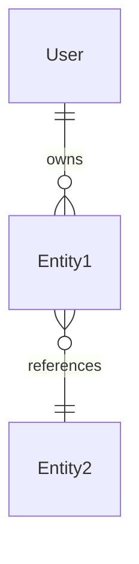
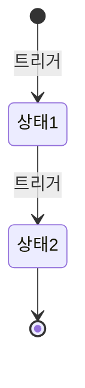
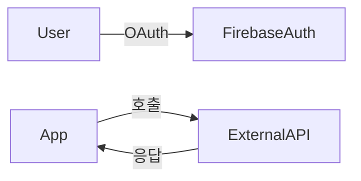

# spec.md 완전 템플릿

`spec-planner`가 생성하는 `{out}/spec.md`의 완전 골격.

> ⚠️ 섹션 헤딩에 **번호를 붙이지 않는다** (계약 FMT-02, 게이트가 경고한다).
> 산출물 규약(ID 형식, 근거 태그, 우선순위 표기)은 `contracts/artifact-contract.md`를 따른다. 충돌하면 계약이 우선한다.
> 본문에서 섹션을 지칭할 때는 "## 기능 요구사항" 처럼 그대로 사용.

---

## 📑 섹션 순서 (총 21개)

```
1.  프로젝트 개요
2.  조사 근거
3.  기능 요구사항
4.  범위 제외                      ← 신규 (Won't·하지 않기로 한 항목. FR을 만들지 않는다)
5.  유스케이스 명세                ← 신규 (FR과 직접 연결)
6.  비기능 요구사항
7.  제약 조건
8.  가정
9.  사용자 스토리
10. 권한 매트릭스                  ← 신규 (역할 정의)
11. 화면 구조
12. 데이터 모델 (개념)             ← 신규 (엔티티 + 관계 + 양 추정)
13. 상태 전이                     ← 신규 (핵심 엔티티 상태)
14. 외부 시스템 카탈로그           ← 신규 (연동 시스템)
15. 도메인 규칙                   ← 신규 (계산 공식, 정책)
16. Candidate Requirements
17. Risk Assessment
18. KPI
19. 마일스톤
20. 검증 기록
21. 변경 이력
```

---

## 템플릿 전문

```markdown
# {프로젝트명} 명세 (spec.md)

> 작성일: {YYYY-MM-DD}  |  모드: {신규 | 수정 v{N} | 재조사}
> 출처: spec-planner

---

## 프로젝트 개요

- **이름**: {프로젝트명}
- **목적**: {해결하려는 문제 1~2문장}
- **대상 사용자**:
  - 주 타겟: {연령/직업/특성}
  - 부 타겟: {추가 타겟}
- **차별화 포인트**:
  - {강점 1}
  - {강점 2}
  - {강점 3}

---

## 조사 근거

### 도메인 조사 출처 (최소 3개)

| # | 출처 | URL/참고 | 핵심 발견 | 반영 항목 |
|---|------|---------|----------|----------|
| 1 | {매체} | {URL or [일반 지식 폴백]} | {1줄 요약} | FR-001, CON-002 |

### 경쟁사 분석 (최소 3개)

| 서비스명 | 핵심 기능 | 차별점 | 약점 | 반영 여부 |
|---------|----------|--------|------|----------|

### 기술/시장 트렌드

| 트렌드 | 출처 | 적용 판단 |
|--------|------|----------|

---

## 기능 요구사항

> 각 FR 필수 필드: id, priority(소제목), description, 근거, 관련 US, 관련 UC, 관련 SCR. **P0·P1은 인수 기준 1개 이상** (P2는 선택).
> 인수 기준(`AC-NNN`)은 "무엇이 되면 충족인가"를 관찰할 수 있는 결과로 쓴다 ("잘 동작한다" 금지). 번호는 명세 전체에서 하나의 순번이다. 설계의 시험 계획이 이것을 시험 시나리오로 펼친다.
> 기준이 사용자가 말하지 않은 정책(수치, 문구, 동작)을 새로 정하게 되면 지어내지 말고 사용자 확인 대상으로 남긴다.
> 근거 유형: `[인터뷰: RC-NNN]` / `[PRD: PF-NNN]` / `[사용자 입력]` — **FR은 이 셋 중 하나 이상이 있어야 한다.**
> `[도메인 조사]` / `[경쟁 분석]` / `[사용자 여정]`만 근거인 항목은 FR이 아니라 `## Candidate Requirements`에 둔다.
> 우선순위는 PRD의 우선순위를 옮긴다 (Must=P0, Should=P1, Could=P2). 바꾸려면 사용자 확인이 필요하다.

### P0 (Must Have)
- **FR-001**: {기능 설명}
  - 근거: [인터뷰: RC-001], [PRD: PF-001]
  - 관련 US: US-001
  - 관련 UC: UC-001
  - 관련 SCR: SCR-001
  - 인수 기준:
    - AC-001: {관찰할 수 있는 결과 — 예: 필수 항목이 비면 제출되지 않고 그 칸에 오류 문구가 보인다}
    - AC-002: {…}

### P1 (Should Have)
### P2 (Nice to Have)

---

## 범위 제외

> 인터뷰·PRD 에서 Won't 로 정했거나 이번에 하지 않기로 한 항목. FR 을 만들지 않는다. 없으면 "해당 없음".

- **{제외한 항목}**: {사유}. [인터뷰: RC-NNN] 또는 [PRD: PF-NNN]

---

## 유스케이스 명세

> P0 + 핵심 P1 유스케이스의 상세 흐름. UML Use Case 표준 형식.
> 짧은 사용자 스토리(US)와 달리, 설계자가 API/화면 흐름 설계에 직접 활용 가능한 수준.

### UC-001: {유스케이스명}

- **Actor**: {주 행위자 — User / Trainer / Admin / Guest / System}
- **Goal**: {1줄 목적}
- **Precondition**:
  - {조건 1}
  - {조건 2}
- **Trigger**: {시작 이벤트 — 버튼 탭, 알림, 스케줄러 등}
- **Main Flow**:
  1. {단계 1}
  2. {단계 2}
  3. ...
- **Alt Flow 1: {대안 상황명}**
  - {분기 조건}
  - {대안 흐름}
- **Alt Flow 2: {예외 상황명}**
- **Postcondition**:
  - {결과 상태 1}
  - {결과 상태 2}
- **관련 FR**: FR-001, FR-023
- **관련 SCR**: SCR-005, SCR-006, SCR-007
- **에러 시나리오**: {참조 ID — 도메인 규칙의 에러 카탈로그}

> 최소 작성 대상: **모든 P0 US에 대응하는 UC**.
> P1 UC는 핵심만 (alt flow가 복잡한 경우 우선).

---

## 비기능 요구사항

> 각 NFR은 측정 가능한 수치 + 측정 환경 필수.

- **NFR-001** (성능): {예: 운동 기록 저장 응답 P95 1초 이내 (4G/WiFi)}
- **NFR-002** (성능): ...
- **NFR-003** (보안): ...
- **NFR-004** (안정성): ...
- **NFR-005** (확장성): ...
- **NFR-006** (접근성): WCAG 2.1 Level AA
- **NFR-009** (보안 - 암호화): ...
- **NFR-010** (감사): ...

---

## 제약 조건

- **CON-001**: 플랫폼 — {예: iOS 14+, Android 8+}
- **CON-002**: {규제} [규제]
- **CON-003**: {규제}
- **CON-004**: {외부 의존성}

---

## 가정

> ASM은 반드시 `[가정]` 태그와 `설계 영향` 줄. 가정이 사실인지는 조사하지 않고, 설계가 무엇에 기대는지를 드러낸다 (기준: requirements-analyst.md 6, 게이트 VAL-20).

- **ASM-001** [가정]: ...
  - 설계 영향: 낮음 — {이 가정이 틀리면 무엇이 바뀌는가}
- **ASM-002** [가정]: ...
  - 설계 영향: 높음 — {바뀌는 설계 문서}

---

## 사용자 스토리

### US-001: {제목}
- **AS**: {역할}
- **I WANT**: {기능}
- **SO THAT**: {가치}
- **관련 FR**: FR-001, FR-002
- **관련 UC**: UC-001

---

## 권한 매트릭스

> 사용자 역할(Role)별 기능 권한. 설계자가 인증/권한 모듈 설계 시 입력값.

### 역할 정의

| Role | 정의 | 도입 Phase |
|------|------|-----------|
| Guest | 비로그인 사용자 | Phase 1 |
| User | 일반 회원 | Phase 1 |
| Trainer | 트레이너 (회원 기록 조회) | Phase 2~ |
| Admin | 운영자 (모더레이션) | Phase 3~ |

### 기능 권한 표

> ✅ 허용, ❌ 차단, - 해당 없음, ⚠️ 조건부 (조건 명시)

| 기능 / FR | Guest | User | Trainer | Admin |
|----------|-------|------|---------|-------|
| 온보딩 (SCR-001~002) | ✅ | ✅ | ✅ | ✅ |
| 회원가입 (FR-004) | ✅ | - | - | - |
| 운동 기록 작성 (FR-001) | ❌ | ✅ (본인) | ❌ | ❌ |
| 운동 기록 조회 (FR-002) | ❌ | ✅ (본인) | ⚠️ (담당 회원, 동의 시) | ✅ (모든) |
| 친구 차단/신고 (FR-025/026) | ❌ | ✅ (본인 관계) | ❌ | ❌ |
| 신고 처리 (FR-026 응답) | ❌ | ❌ | ❌ | ✅ |
| AI 추천 (FR-022) | ❌ | ⚠️ (FR-008 동의 시) | ❌ | ❌ |

### 게스트/비로그인 허용 범위
- {허용 화면/기능 명시 — 없으면 "회원가입 외 모두 차단"}

---

## 화면 구조

### 화면 흐름도

```text
{스플래시 → 온보딩 → 로그인 → 홈 → 기능별 화면}
```

### 주요 화면 정의

| ID | 화면명 | 목적 | 주요 구성 요소 | 관련 FR | 관련 US | 관련 UC |
|----|--------|------|---------------|---------|---------|---------|
| SCR-001 | ... | ... | ... | FR-xxx | US-xxx | UC-xxx |

> ⚠️ 모든 P0 FR은 최소 1개 SCR + 1개 UC와 매핑되어야 함.

---

## 데이터 모델 (개념)

> ⚠️ 추상화 수준 = **논리/개념**. ERD/스키마/인덱스는 설계 단계(design-architect)에 위임.
> 본 섹션은 설계자가 ERD/DB 선택 결정에 직접 활용할 입력값.

### 주요 엔티티

| 엔티티 | 설명 | 필수 속성 | 선택 속성 | 라이프사이클 |
|--------|------|----------|----------|------------|
| User | 회원 | id, email, createdAt | name, age, goal | 가입~탈퇴 |
| {엔티티명} | ... | ... | ... | ... |

### 엔티티 관계



> ERD 표기법: 1:1 = `||--||`, 1:N = `||--o{`, N:M = `}o--o{`.
> 카디널리티만 표시. 컬럼·인덱스는 design-architect 단계.

### 데이터 양 추정

| 엔티티 | 사용자당 / 일 | 1년 누적 (사용자당) | 시스템 전체 1년 (DAU {N} 가정) | 보존 정책 |
|--------|--------------|---------------------|------------------------------|----------|
| {엔티티} | {예: 30~50건} | {예: 15,000건} | {예: 25~75M} | {영구 / 90일 / 탈퇴 시 30일} |

### 설계 영향
- {예: 1년 75M 레코드 → RDBMS 적합 또는 NoSQL 샤딩 필요}
- {예: 통계 집계는 사전 캐싱 권장}
- {예: 민감 정보 별도 암호화 컬럼 (NFR-009 연계)}

---

## 상태 전이

> 핵심 엔티티의 상태 흐름. 설계자가 상태 머신 + DB 컬럼 + 이벤트 설계 시 입력값.

### {엔티티명}



| 상태 | 진입 조건 | 가능 액션 | 다음 상태 |
|------|----------|----------|----------|
| {상태1} | {조건} | {액션} | {상태2} |

> 최소 작성 대상: 비자명한 상태 흐름을 가진 엔티티 (운동 기록, 친구 관계, 결제, 신고 등).
> CRUD만 있는 단순 엔티티는 생략.

---

## 외부 시스템 카탈로그

> 연동할 외부 시스템 목록. 설계자가 SDK 선택/통합 아키텍처 결정 시 입력값.
> API 엔드포인트/메서드 명세는 설계 단계.

| 시스템 | 목적 | 의존성 | 데이터 방향 | 관련 FR/Cand | 인증 방식 | 비고 |
|--------|------|--------|------------|-------------|---------|------|
| Google OAuth | 소셜 로그인 | 필수 (P0) | 단방향 (수신) | FR-004 | OAuth 2.0 | - |
| Apple Sign In | 소셜 로그인 | 필수 (P0) | 단방향 | FR-004 | OAuth 2.0 | iOS 13+ 필수 |
| Firebase Auth | 인증 백엔드 | 필수 (P0) | 양방향 | FR-004 | API Key | ASM-002 |
| {시스템명} | {목적} | {필수/선택/조건부} | {양방향/단방향} | {FR/Cand} | {인증} | {비고} |

### 의존성 분류
- **필수 (Hard Dependency)**: 시스템 없이는 핵심 기능 불가
- **선택 (Soft Dependency)**: fallback 가능
- **조건부 (Conditional)**: 특정 사용자/조건에서만

### 데이터 흐름 (선택, 복잡한 통합 시)


---

## 도메인 규칙

> 비즈니스 룰, 계산 공식, 정책. 설계자가 도메인 레이어 설계 시 직접 활용.

### 계산 공식

- **{공식명}**: `결과 = 입력1 op 입력2`
- 예: 1RM 추정 (Epley): `1RM = weight × (1 + reps / 30)`

### 검증 규칙

| 대상 | 규칙 | 위반 시 동작 |
|------|------|------------|
| {필드} | {범위/형식} | {에러 메시지/거부} |

### 정책

- **{정책명}**: {정책 내용}
- 예: **차단 정책**: 차단된 사용자의 모든 콘텐츠 자동 숨김. 차단 해제 시 즉시 복원.
- 예: **신고 처리 SLA**: 접수 후 72시간 내 1차 응답.
- 예: **데이터 삭제**: 사용자 탈퇴 시 30일 보존 후 영구 삭제 (개인정보보호법).

### 도메인 용어 (Glossary)

| 용어 | 정의 |
|------|------|
| {용어} | {정의} |

> 도메인 조사(domain-research.md)의 용어 중 spec.md 본문에서 사용되는 핵심만 발췌.

---

## Candidate Requirements

> 조사·여정 기반 추천 후보. 확정 아님. 사용자 확인 후 FR로 승격 가능.

- **CAND-001** (출처: {도메인 조사/경쟁 분석/여정}): {기능 설명}

---

## Risk Assessment

| ID | 분류 | 리스크 | 영향도 | 대응 |
|----|------|--------|--------|------|
| RISK-001 | 기술 | ... | High/Medium/Low | ... |

---

## KPI

| ID | 분류 | 지표 | 측정 방법 | 목표 (3개월) | 목표 (1년) | 관련 FR |
|----|------|------|----------|-------------|-----------|---------|

### 측정 도구

- 사용자 행동: ...
- 크래시·성능: ...

---

## 마일스톤

### Phase 1: MVP (총 {N}주)

| ID | 마일스톤 | 기간 | 포함 FR/SCR/UC | 완료 기준 |
|----|---------|------|---------------|----------|

### Phase 2: 확장 (이후 {N}주)
### Phase 3: 출시 준비 ({N}주)

### 의존성

- {MS-002 → MS-001 완료 필요}

---

## 검증 기록

> 4-페르소나 병렬 리뷰 결과. 누가 무엇을 지적했고 어떻게 처리했는지.

### Run {YYYY-MM-DD HH:mm}

**리뷰 요약**
- Critical Reviewer: {verdict}, issues {N}
- Technical Reviewer: {verdict}, issues {N}
- User Advocate: {verdict}, issues {N}
- Business Reviewer: {verdict}, issues {N}

**Consensus (자동 수정됨)**
- `[CRITICAL × 2]` ... → {target_ref}: {수정 내용}

**Single-Persona WARN (사용자 결정)**
- `[WARN]` ... → {target_ref}: {description}
  - 사용자 결정: {수정/기록/기각}

**INFO (기록만)**
- `[INFO × N]` ...

**Rejected**
- `[INFO]` ... (사유)

---

## 변경 이력

| 버전 | 일자 | 변경 요약 | 추가 ID | 삭제 ID |
|------|------|----------|---------|---------|
| v1 | YYYY-MM-DD | 초기 작성 | FR-001~ | - |
```

---

## 필수 규칙 (강제)

| # | 규칙 | 위반 시 |
|---|------|---------|
| 1 | 모든 FR에 `근거` 필드 | Critical Reviewer WARN |
| 2 | ASM은 `[가정]` 태그와 `설계 영향` 줄 | Critical Reviewer WARN |
| 3 | NFR은 측정 수치 + 환경 필수 | Technical Reviewer CRITICAL |
| 4 | 도메인 조사 출처 ≥ 3개 | Critical Reviewer WARN |
| 5 | 경쟁사 분석 ≥ 3개 | 동일 |
| 6 | WebSearch 실패 시 `[일반 지식 폴백]` 태그 | 자체 규칙 |
| 7 | 모든 P0 FR이 최소 1개 SCR + 1개 UC + 1개 여정에 등장 | User Advocate CRITICAL |
| 8 | Candidate은 별도 섹션 (FR과 분리) | 추천과 확정 분리 |
| 9 | 섹션 헤딩에 번호 붙이지 않음 | 계약 FMT-02 |
| 10 | 수정 모드 ID 충돌 회피 (max+1, 삭제 ID 재사용 금지) | 참조 무결성 |
| 11 | 모든 P0 UC가 `Main Flow` + 최소 1개 `Alt Flow` 보유 | User Advocate WARN |
| 12 | 권한 매트릭스의 모든 FR이 Role × Function 셀에 정의 | Technical Reviewer WARN |
| 13 | 외부 시스템 카탈로그가 FR-* 또는 CAND-*와 매핑 | Technical Reviewer WARN |
| 14 | 데이터 모델의 모든 엔티티가 최소 1개 FR과 연결 | Critical Reviewer WARN |

---

## ID 체계 종합

| 종류 | ID 패턴 | 용도 |
|------|---------|------|
| 기능 요구사항 | `FR-NNN` | 시스템 동작 |
| 비기능 요구사항 | `NFR-NNN` | 품질 속성 |
| 제약 조건 | `CON-NNN` | 기술/규제 |
| 가정 | `ASM-NNN` | `[가정]` 태그 필수, 아래 줄에 `- 설계 영향: 높음/보통/낮음` |
| 사용자 스토리 | `US-NNN` | AS/I WANT/SO THAT |
| 유스케이스 | `UC-NNN` | UML 상세 명세 |
| 화면 | `SCR-NNN` | 화면/뷰 단위 |
| 후보 요구사항 | `CAND-NNN` | 추천 후보 |
| 리스크 | `RISK-NNN` | 식별된 리스크 |
| KPI | `KPI-NNN` | 성공 지표 |
| 마일스톤 | `MS-NNN` | 일정 단위 |
| (엔티티) | `Entity` 명 (PascalCase) | 데이터 모델 |
| (Role) | `Role` 명 | 권한 매트릭스 |

---

## 신규 모드 vs 수정 모드 차이

| 섹션 | 신규 모드 | 수정 모드 |
|------|----------|----------|
| 검증 기록 | 1회 Run | 이전 Run + 새 Run 누적 |
| 변경 이력 | v1 행만 또는 비움 | v1~vN 누적 |
| 기타 모든 섹션 | 처음부터 작성 | 기존 + 변경 부분 갱신 |
