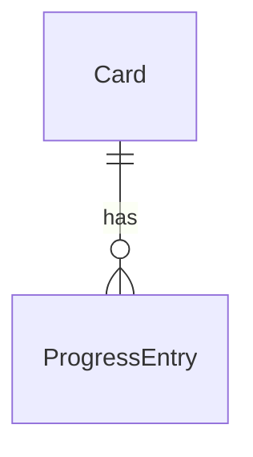
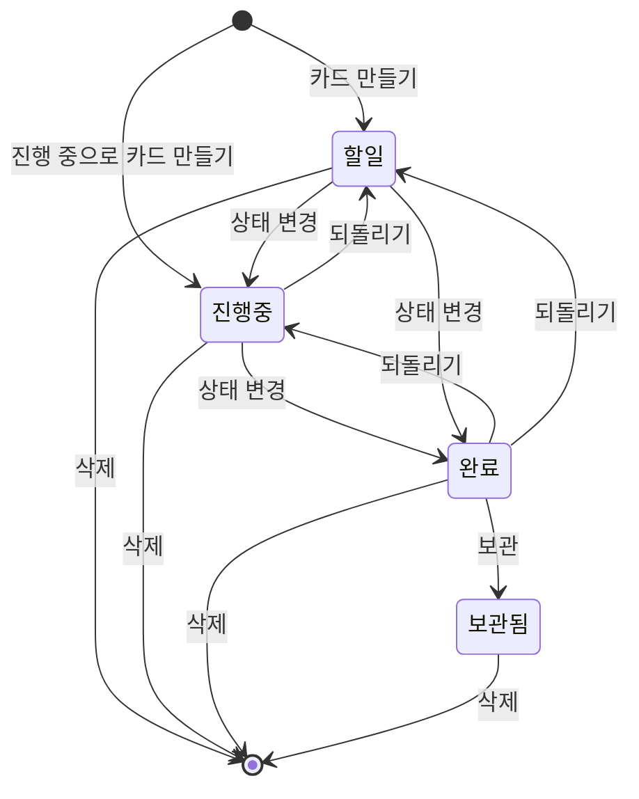

# 1인 사용자용 스케줄 관리 칸반보드 명세 (spec.md)

> 작성일: 2026-11-03  |  모드: 신규
> 출처: spec-planner (입력: docs/03-prd/prd.md 승인, docs/01-interview/interview.md 확정)

---

## 프로젝트 개요

- **이름**: 1인 사용자용 스케줄 관리 칸반보드
- **목적**: 본인 1명이 개발 버그와 일반 할 일을 한 보드에 모아, 등록부터 해결까지 상태별 보드와 캘린더로 관리한다. 지금 쓰는 도구가 없어서 직접 만든다 (인터뷰 R1).
- **대상 사용자**:
  - 주 타겟: 본인 1명. 내 PC 한 대에서 쓰고 인터넷이 없어도 동작해야 한다
  - 부 타겟: 없음 (계정·공유 기능 없음)
- **차별화 포인트**: 시장 차별화는 목표가 아니다. 이 도구는 본인이 쓰려고 직접 만든다 (인터뷰 R1). 사용자가 차별화를 말하지도 않았다. 아래는 조사에서 확인한 사실이다.
  - 서버·계정 없이 내 PC에만 저장하고 오프라인으로 동작한다 (D-005). 이 특성은 Kanri 같은 오프라인 개인용 앱과 겹쳐서 차별점이 아니다
  - 칸은 할 일, 진행 중, 완료 세 개로 고정해 단순하다 (D-001)
  - 캘린더 보기를 필수로 둔다. 일부 경쟁 도구는 캘린더 뷰가 유료라는 서술이 있으나 근거가 벤더 글 하나(LOW)이고 Kanri에 캘린더가 있는지는 확인하지 못했다 (조사 S2)

---

## 조사 근거

### 도메인 조사 출처 (최소 3개)

| # | 출처 | URL/참고 | 핵심 발견 | 반영 항목 |
|---|------|---------|----------|----------|
| 1 | 퍼스널 칸반 글 묶음 | https://www.lean.org/the-lean-post/articles/six-personal-kanban-habits-to-avoid, https://www.infoq.com/news/2014/12/convince-limit-WIP | 일을 시각화하고 WIP를 제한한다는 두 규칙. WIP 제한이 없으면 칸반이라 보기 어렵다는 주장 | CAND-001 |
| 2 | Trello 대안 비교 글 묶음 | https://www.toolworthy.ai/blog/trello-alternatives, https://efficient.app/compare/todoist-vs-trello | 범용 도구는 보드 뷰를 제공하고, Todoist는 캘린더 뷰가 유료. 단순한 보드를 선호한다는 평가 (벤더 글, LOW) | FR-005, ASM-002 |
| 3 | 셀프호스팅 칸반 비교 글 묶음 | https://openalternative.co/compare/kanri/vs/planka, https://vikunja.io/compare/planka | Kanri는 오프라인 개인용 앱, Planka·Vikunja는 서버형 (LOW) | CON-001 |
| 4 | Electron·Tauri 비교 글 묶음 | https://www.pkgpulse.com/guides/electron-vs-tauri-2026, https://www.raftlabs.com/blog/tauri-vs-electron-pros-cons | 웹/Electron 선택은 조사만으로 정할 수 없다. PWA·로컬 저장은 다뤄지지 않았다 (LOW) | CON-002, ASM-003 |

### 경쟁사 분석 (최소 3개)

| 서비스명 | 핵심 기능 | 차별점 | 약점 | 반영 여부 |
|---------|----------|--------|------|----------|
| Trello | 드래그 앤 드롭 칸반 보드 | 학습 부담이 적다는 평가 | 방향 변화(Inbox·Planner·AI)가 대안 탐색의 배경으로 언급됨 | 미반영 (참고) |
| Todoist | 리스트·보드 뷰 | 기본기 중심 | 캘린더 뷰는 유료라는 서술 | FR-005 |
| Kanri | 오프라인 개인용 칸반 | 무료 오픈소스, 오프라인 | 규모가 작고 독립 리뷰 없음 | CON-001 (오프라인·로컬 특성은 Kanri와 같아 차별점이 아니다) |
| Planka | 칸반 전용 셀프호스팅 | 칸반에 집중 | 서버 설치·운영이 필요 | 미반영 (서버 없음, D-005) |

### 기술/시장 트렌드

| 트렌드 | 출처 | 적용 판단 |
|--------|------|----------|
| Electron은 성숙하나 크고, Tauri는 작으나 OS별 렌더링 차이 가능 | docs/02-research/01-overview.md S4 | 보류: 웹/Electron은 설계 단계에서 사용자가 결정 (Q-005) |
| 범용 도구의 AI·자동화 강화 | docs/02-research/01-overview.md S2 | 미적용: 사용자가 요구하지 않았고 로컬·오프라인 전제와 맞지 않는다 |

---

## 기능 요구사항

> 우선순위는 승인된 PRD의 값을 옮겼다 (Must=P0, Should=P1). 바꾼 것은 없다.

### P0 (Must Have)

- **FR-001**: 카드를 만든다. 보드에서 관리할 개발 버그나 할 일 한 건을 카드로 만든다.
  - 근거: [인터뷰: RC-001], [PRD: PF-001]
  - 관련 US: US-001
  - 관련 UC: UC-001
  - 관련 SCR: SCR-001, SCR-002
  - 인수 기준:
    - AC-001: 상태를 고르지 않고 제목을 입력해 저장하면 새 카드가 기본 상태인 할 일 칸에 나타난다 (ASM-004)
    - AC-002: 제목이 비어 있으면 카드가 만들어지지 않고 제목 입력 칸에 오류 문구가 보인다 (ASM-006)
    - AC-041: 카드를 만들 때 상태를 진행 중으로 고르고 저장하면 새 카드가 진행 중 칸에 나타난다 (ASM-004)
    - AC-042: 카드를 만들 때 고를 수 있는 상태는 할 일과 진행 중 두 가지뿐이고 완료로는 만들 수 없다. 처음 열었을 때 선택된 상태는 할 일이다 (ASM-004)

- **FR-002**: 카드의 상태를 바꾼다. 상태는 할 일, 진행 중, 완료 세 가지다.
  - 근거: [인터뷰: RC-002], [PRD: PF-002]
  - 관련 US: US-002
  - 관련 UC: UC-002
  - 관련 SCR: SCR-001, SCR-002
  - 인수 기준:
    - AC-003: 카드의 상태를 바꾸면 그 카드가 바뀐 상태의 칸으로 옮겨져 보인다
    - AC-004: 상태로 고를 수 있는 값은 할 일, 진행 중, 완료 세 가지뿐이다. 보관은 상태 값이 아니다

- **FR-003**: 카드를 상태별로 모아 한 화면에서 본다.
  - 근거: [인터뷰: RC-003], [PRD: PF-003]
  - 관련 US: US-002
  - 관련 UC: UC-002, UC-003
  - 관련 SCR: SCR-001
  - 인수 기준:
    - AC-005: 할 일, 진행 중, 완료 세 칸이 한 화면에 나란히 보이고, 각 카드는 자기 상태의 칸에만 있다
    - AC-006: 카드가 하나도 없는 칸은 빈 칸으로 보이고 오류 없이 화면이 열린다

- **FR-004**: 카드에 마감일을 적는다. 캘린더 보기의 전제다.
  - 근거: [인터뷰: RC-006], [PRD: PF-004]
  - 관련 US: US-001, US-003
  - 관련 UC: UC-001, UC-004
  - 관련 SCR: SCR-001, SCR-002, SCR-003
  - 인수 기준:
    - AC-007: 카드에 날짜를 마감일로 입력해 저장하면 카드를 열었을 때 그 마감일이 보인다
    - AC-008: 마감일을 비워 두어도 카드가 저장된다 (ASM-005)
    - AC-029: 존재하지 않는 날짜를 마감일로 입력하면 카드가 저장되지 않고 마감일 입력 칸에 오류 문구가 보인다
    - AC-043: 마감일 입력 칸에서 달력을 열어 날짜를 고르면 그 날짜가 마감일 칸에 들어가고 저장하면 카드에 그 마감일이 보인다. 날짜를 직접 입력하는 방법도 그대로 쓸 수 있다

- **FR-005**: 카드를 날짜 기준 캘린더로도 보고, 캘린더에서 카드를 끌어 다른 날짜로 옮겨 마감일을 바꾼다.
  - 근거: [인터뷰: RC-010], [PRD: PF-005]
  - 관련 US: US-003
  - 관련 UC: UC-004
  - 관련 SCR: SCR-003
  - 인수 기준:
    - AC-009: 캘린더 화면에서 마감일이 있는 카드가 그 마감일의 날짜 칸에 보인다
    - AC-010: 마감일이 없는 카드는 캘린더에 나타나지 않고 보드에는 그대로 보인다 (ASM-005)
    - AC-030: 캘린더에서 카드를 고르면 그 카드의 입력·상세 화면이 열린다
    - AC-044: 월 보기와 주 보기 모두에서 캘린더의 카드를 다른 날짜 칸으로 끌어다 놓으면 저장에 성공한 뒤 그 카드가 놓은 날짜 칸에 보이고, 카드를 열면 마감일이 그 날짜로 바뀌어 있다. 상태와 다른 내용은 바뀌지 않는다 (ASM-018)
    - AC-045: 카드를 원래 있던 날짜 칸에 놓거나 날짜 칸 밖에 놓으면 아무것도 바뀌지 않고 저장도 일어나지 않는다
    - AC-046: 끌어다 놓은 변경의 저장에 실패하면 카드는 원래 날짜 칸에 그대로 있고 마감일도 바뀌지 않으며, 저장 실패 문구와 다시 저장하는 방법이 보인다 (AC-031과 같은 방식)
    - AC-048: 한 달이 5주인 달의 월 보기 캘린더는 앱을 처음 열었을 때의 창 크기에서 스크롤 없이 모든 주와 요일 줄이 보인다. 창을 더 작게 줄이면 캘린더 안에서 스크롤된다

- **FR-006**: 데이터를 내 PC에 저장하고 인터넷 없이 동작한다.
  - 근거: [인터뷰: RC-011], [PRD: PF-006]
  - 관련 US: US-004
  - 관련 UC: UC-005
  - 관련 SCR: SCR-001
  - 인수 기준:
    - AC-011: 카드를 만들거나 바꾼 뒤 앱을 닫았다 다시 열면 저장해 둔 카드와 상태가 그대로 보인다
    - AC-012: PC가 인터넷에 연결되지 않은 상태에서도 카드 만들기, 상태 변경, 캘린더 보기가 된다
    - AC-031: 저장에 실패하면 저장 실패를 알리는 문구가 화면에 보이고, 입력한 내용은 화면에서 지워지지 않는다
    - AC-032: 앱을 열 때 저장된 데이터를 읽지 못하면 빈 보드와 구분되는 오류 안내가 보이고, 읽지 못한 데이터는 새 저장으로 덮어쓰이지 않는다

### P1 (Should Have)

- **FR-007**: 카드에 종류(개발 버그/할 일)를 표시한다. 같은 카드에 종류 표시만 다르게 한다.
  - 근거: [인터뷰: RC-004], [PRD: PF-007]
  - 관련 US: US-001
  - 관련 UC: UC-001
  - 관련 SCR: SCR-001, SCR-002
  - 인수 기준:
    - AC-013: 카드를 만들 때 종류를 개발 버그 또는 할 일 중에서 고르면, 보드의 카드에서 두 종류가 구분되어 보인다
    - AC-014: 종류를 고르지 않고 저장하면 종류가 할 일로 저장된다 (ASM-007)

- **FR-008**: 카드에 상세 설명, 우선순위, 추가 메모를 적는다.
  - 근거: [인터뷰: RC-005], [인터뷰: RC-007], [인터뷰: RC-008], [PRD: PF-008]
  - 관련 US: US-001
  - 관련 UC: UC-001, UC-009
  - 관련 SCR: SCR-001, SCR-002
  - 인수 기준:
    - AC-015: 상세 설명, 우선순위, 추가 메모를 입력해 저장한 뒤 카드를 열면 입력한 내용이 그대로 보인다
    - AC-016: 우선순위는 없음, 낮음, 중간, 높음 중에서 고르고(이 순서로 보인다), 없음을 고르거나 고르지 않아도 카드가 저장된다 (ASM-008)

- **FR-009**: 카드별로 진행 단계마다 추가 이슈와 검토사항 기록을 직접 남기고 남긴 순서대로 되짚어 본다.
  - 근거: [인터뷰: RC-009], [PRD: PF-009]
  - 관련 US: US-005
  - 관련 UC: UC-006
  - 관련 SCR: SCR-002
  - 인수 기준:
    - AC-017: 카드에서 기록을 추가하면 그 카드의 기록 목록에 남긴 순서대로 쌓여 보이고, 다른 카드의 기록 목록에는 나타나지 않는다
    - AC-018: 각 기록에는 그 기록을 남긴 때의 카드 상태(진행 단계)가 함께 보인다
  - 결정 필요: 상태 변경 같은 변화를 자동으로 이력에 남길지 (Q-002). 정해지기 전까지 자동 이력은 요구 범위 밖이다 (ASM-009). 정해지면 별도 항목으로 추가한다.

- **FR-010**: 완료한 카드를 보관(숨김)하고 보관한 카드를 다시 찾아본다.
  - 근거: [인터뷰: RC-012], [PRD: PF-010]
  - 관련 US: US-006
  - 관련 UC: UC-007
  - 관련 SCR: SCR-001, SCR-002, SCR-004
  - 인수 기준:
    - AC-019: 완료 카드를 보관하면 보드와 캘린더에서 보이지 않는다
    - AC-020: 보관한 카드는 보관함 화면의 목록에서 찾아 내용을 볼 수 있다
    - AC-021: 완료가 아닌 카드는 보관할 수 없다 (ASM-013)

- **FR-011**: 카드를 수정하고 삭제한다.
  - 근거: [인터뷰: RC-013], [PRD: PF-011]
  - 관련 US: US-007
  - 관련 UC: UC-009
  - 관련 SCR: SCR-002, SCR-004
  - 인수 기준:
    - AC-022: 카드의 내용을 고치고 저장하면 보드와 캘린더에 고친 내용이 보인다
    - AC-023: 삭제를 확인하면 카드가 보드와 캘린더에서 사라지고, 앱을 다시 열어도 나타나지 않는다
    - AC-033: 삭제를 선택하면 바로 지워지지 않고 확인 단계가 보이며, 확인 단계에서 취소하면 카드가 그대로 남는다
    - AC-034: 카드를 삭제하면 그 카드의 진행 기록도 함께 사라진다
    - AC-035: 카드를 수정하다가 제목을 비우면 저장되지 않고 제목 입력 칸에 오류 문구가 보인다
    - AC-040: 보관한 카드도 보관함에서 삭제할 수 있고, 확인 단계 뒤 삭제하면 그 카드와 진행 기록이 함께 사라진다 (수정은 할 수 없다, ASM-015)

- **FR-012**: 마감이 지난 카드를 보드에서 구분해 보여 준다. 임박 표시와 알림 방식은 정해지지 않았다 (Q-004).
  - 근거: [인터뷰: RC-014], [PRD: PF-012]
  - 관련 US: US-008
  - 관련 UC: UC-008
  - 관련 SCR: SCR-001
  - 인수 기준:
    - AC-024: 마감일이 오늘보다 앞이고 완료가 아닌 카드는 보드에서 마감이 지난 카드로 구분되어 보인다 (ASM-014)
    - AC-025: 완료 상태의 카드는 마감일이 지났어도 마감이 지난 카드로 구분되지 않는다
  - 결정 필요: "임박"의 기준(며칠 전부터인지)과 PC 알림을 쓸지 (Q-004). 정해지기 전까지 임박 표시와 PC 알림은 요구 범위 밖이다 (ASM-011). 정해지면 별도 항목으로 추가한다.

- **FR-013**: 카드를 검색하고 종류·우선순위로 거른다.
  - 근거: [인터뷰: RC-015], [PRD: PF-013]
  - 관련 US: US-009
  - 관련 UC: UC-010, UC-007
  - 관련 SCR: SCR-001, SCR-004
  - 인수 기준:
    - AC-026: 검색어를 입력하면 제목에 그 글자가 들어 있는 카드만 보인다 (ASM-012)
    - AC-027: 종류나 우선순위를 고르면 그 값을 가진 카드만 보이고, 여러 조건을 함께 고르면 모든 조건을 만족하는 카드만 보이며, 조건을 지우면(전체를 고르면) 모든 카드가 다시 보인다 (ASM-012)
    - AC-047: 사이드바의 종류와 우선순위 목록에는 각각 전체 항목이 있고, 처음 열었을 때와 조건이 없을 때 전체가 선택되어 있다. 전체를 고르면 그 목록의 조건이 지워진다. 한 목록에서는 항목 하나만 선택되고, 선택된 항목을 다시 눌러도 해제되지 않는다. 우선순위 목록의 순서는 전체, 없음을 뺀 낮음, 중간, 높음이다 (ASM-012)
    - AC-028: 보관함 화면에서 검색하면 보관한 카드가 결과에 나오고, 보드 화면의 검색 결과에는 보관한 카드가 나오지 않는다
    - AC-036: 조건에 맞는 카드가 없으면 맞는 카드가 없다는 표시가 보이고, 적용 중인 검색어·조건이 화면에 보인다

- **FR-014**: 화면을 어두운 판과 밝은 판 중에서 사용자가 전환해 쓴다.
  - 근거: [사용자 입력]
  - 관련 US: US-010
  - 관련 UC: UC-011
  - 관련 SCR: SCR-001
  - 인수 기준:
    - AC-037: 밝기 전환을 선택하면 모든 화면이 선택한 판(어두운 판 또는 밝은 판)으로 바뀐다
    - AC-038: 선택한 판은 앱을 닫았다 다시 열어도 유지되고, 처음 실행할 때(저장된 선택이 없을 때)는 밝은 판이다. 이미 저장된 선택은 바꾸지 않는다 (ASM-017)
    - AC-039: 어두운 판과 밝은 판 모두에서 카드 종류와 마감이 지난 표시가 색 외에 글자나 아이콘으로도 구분된다 (NFR-004)
  - 비고: PRD에 없던 기능이다. 설계 단계의 시안 선택(V-A 밀도형 도구)에서 사용자가 "어두운 화면만"이 아니라 "밝은 판도 함께, 사용자가 전환"을 골랐다. 우선순위는 사용자가 말하지 않아 P1로 두었고, 승인 때 확인한다.

### P2 (Nice to Have)

해당 없음 (PRD에 Could 기능이 없다)

---

## 범위 제외

> 인터뷰 결정(D)으로 하지 않기로 한 항목이다. Won't로 정한 후보(RC)는 없다.

- **여러 기기 동기화와 모바일**: 내 PC 한 대에서만 쓴다. [인터뷰: D-004]
- **계정·공유 기능과 서버 저장**: 서버와 계정 없이 PC에 저장한다. [인터뷰: C-001], [인터뷰: D-005]
- **데이터 백업·내보내기**: 사용자가 기각했다(이유는 말하지 않음). PC 고장 시 데이터 유실은 감수한다. [인터뷰: D-009]
- **칸을 추가·수정하는 기능**: 칸은 할 일, 진행 중, 완료 세 개로 고정한다. [인터뷰: D-001]
- **종류별로 입력 항목이 다른 카드**: 개발 버그와 할 일은 같은 카드에 종류 표시만 다르게 한다. [인터뷰: D-002]
- **같은 앱을 동시에 하나만 실행되게 막는 기능**: 명세 검토에서 제안했으나 사용자가 기각했다(이유는 말하지 않음). 두 창으로 열어 저장하면 덮어써질 수 있다는 점은 감수한다.

---

## 유스케이스 명세

### UC-001: 카드 만들기

- **Actor**: User
- **Goal**: 개발 버그나 할 일 한 건을 카드로 등록한다
- **Precondition**:
  - 앱이 열려 있다
- **Trigger**: 보드 화면에서 카드 만들기를 선택한다
- **Main Flow**:
  1. 사용자가 카드 입력 화면을 연다
  2. 제목을 입력한다. 종류는 고르지 않아도 된다 (종류는 FR-007, 마일스톤 MS-002 범위)
  3. 필요하면 마감일을 입력한다(달력에서 고르거나 직접 입력). 상태는 기본 할 일이고 진행 중으로 바꿔 만들 수 있다(완료는 고를 수 없다). 상세 설명, 우선순위, 추가 메모는 FR-008 범위(MS-002)다
  4. 저장한다
  5. 시스템이 카드를 저장하고 고른 상태(기본 할 일)의 칸에 보여 준다
- **Alt Flow 1: 제목이 비어 있음**
  - 제목 없이 저장을 시도하면 카드를 만들지 않고 제목 칸에 오류 문구를 보인다
- **Alt Flow 2: 입력 중 취소**
  - 저장하지 않고 닫으면 카드가 만들어지지 않는다
- **Alt Flow 3: 마감일이 잘못됨**
  - 존재하지 않는 날짜를 입력하면 카드를 저장하지 않고 마감일 칸에 오류 문구를 보인다
- **Postcondition**:
  - 새 카드가 고른 상태(기본 할 일, 또는 진행 중)로 저장되어 있다
- **관련 FR**: FR-001, FR-004, FR-007, FR-008
- **관련 SCR**: SCR-001, SCR-002

### UC-002: 카드 상태 바꾸기

- **Actor**: User
- **Goal**: 카드가 진행되는 만큼 상태를 바꾼다
- **Precondition**:
  - 보드에 카드가 하나 이상 있다
- **Trigger**: 사용자가 카드의 상태를 바꾸려고 한다
- **Main Flow**:
  1. 사용자가 카드를 고른다
  2. 바꿀 상태(할 일, 진행 중, 완료)를 고른다
  3. 시스템이 상태를 저장하고 카드를 바뀐 칸으로 옮겨 보여 준다
- **Alt Flow 1: 같은 상태를 다시 고름**
  - 상태가 그대로이고 카드 위치도 바뀌지 않는다
- **Alt Flow 2: 완료 카드를 되돌림**
  - 완료 카드를 진행 중이나 할 일로 바꾸면 해당 칸으로 옮겨진다 (ASM-004)
- **Postcondition**:
  - 카드의 상태가 저장되어 앱을 다시 열어도 유지된다
- **관련 FR**: FR-002, FR-003
- **관련 SCR**: SCR-001, SCR-002

### UC-003: 상태별 보드로 진행 상황 보기

- **Actor**: User
- **Goal**: 모든 카드의 진행 상황을 한 화면에서 확인한다
- **Precondition**:
  - 앱이 열려 있다
- **Trigger**: 앱을 열거나 보드 화면으로 이동한다
- **Main Flow**:
  1. 시스템이 할 일, 진행 중, 완료 세 칸을 보여 준다
  2. 각 카드가 자기 상태의 칸에 놓여 있다
  3. 사용자가 칸별 카드를 훑어본다
- **Alt Flow 1: 카드가 하나도 없음**
  - 세 칸이 모두 비어 있는 채로 오류 없이 화면이 열린다
- **Alt Flow 2: 카드가 많음**
  - 카드가 칸에 다 들어가지 않을 때의 표시 방식은 설계에서 정한다. 이 항목은 요구가 아니라 설계에 넘기는 사항이다
- **Postcondition**:
  - 사용자가 상태별 카드 현황을 알고 있다
- **관련 FR**: FR-003
- **관련 SCR**: SCR-001

### UC-004: 캘린더로 보기

- **Actor**: User
- **Goal**: 마감일 기준으로 카드를 날짜별로 본다
- **Precondition**:
  - 앱이 열려 있다
- **Trigger**: 보드에서 캘린더 화면으로 이동한다
- **Main Flow**:
  1. 시스템이 캘린더를 보여 준다
  2. 마감일이 있는 카드가 그 날짜 칸에 보인다
  3. 사용자가 날짜별 카드를 확인하고, 카드를 고르면 그 카드의 입력·상세 화면이 열린다
  4. 사용자가 카드를 다른 날짜 칸으로 끌어다 놓으면 시스템이 그 카드의 마감일을 놓은 날짜로 저장하고, 저장에 성공한 뒤 카드를 그 날짜 칸에 보여 준다
- **Alt Flow 1: 마감일이 없는 카드**
  - 캘린더에는 나타나지 않고 보드에서만 보인다 (ASM-005)
- **Alt Flow 2: 카드가 하나도 없음**
  - 빈 캘린더가 오류 없이 보인다
- **Alt Flow 3: 한 날짜에 카드가 많음**
  - 모든 카드에 접근할 수 있어야 한다. 표시 방식은 설계에서 정한다
- **Alt Flow 4: 같은 날짜 칸이나 날짜 칸 밖에 놓음**
  - 아무것도 바뀌지 않고 저장도 일어나지 않는다
- **Alt Flow 5: 끌어다 놓은 변경의 저장 실패**
  - 카드는 원래 날짜 칸에 그대로 있고 마감일도 바뀌지 않으며, 저장 실패 문구와 다시 저장하는 방법을 보인다 (AC-046)
- **Postcondition**:
  - 사용자가 날짜별 카드 현황을 알고 있다. 카드를 옮겼다면 옮긴 마감일이 저장되어 있다
- **관련 FR**: FR-004, FR-005
- **관련 SCR**: SCR-003, SCR-002

### UC-005: 앱을 열어 저장된 데이터 확인하기

- **Actor**: User
- **Goal**: 이전에 저장한 카드가 앱을 다시 열어도 남아 있는지 확인하고 이어서 쓴다
- **Precondition**:
  - 이전에 카드를 저장했다
  - PC가 인터넷에 연결되어 있지 않아도 된다
- **Trigger**: 앱을 연다
- **Main Flow**:
  1. 사용자가 앱을 연다
  2. 시스템이 PC에 저장된 카드를 읽어 보드에 보여 준다
  3. 사용자가 카드를 만들거나 상태를 바꾼다
  4. 시스템이 변경을 PC에 저장한다
- **Alt Flow 1: 인터넷 없음**
  - 연결이 없어도 1~4가 같게 동작한다
- **Alt Flow 2: 처음 실행**
  - 저장된 카드가 없으면 빈 보드가 보인다
- **Alt Flow 3: 저장 실패**
  - 저장에 실패하면 저장 실패 문구를 보이고 입력한 내용을 화면에 남긴다
- **Alt Flow 4: 저장된 데이터를 읽지 못함**
  - 빈 보드와 구분되는 오류 안내를 보이고, 읽지 못한 데이터를 새 저장으로 덮어쓰지 않는다
- **Postcondition**:
  - 변경한 내용이 PC에 저장되어 있다
- **관련 FR**: FR-006
- **관련 SCR**: SCR-001

### UC-006: 카드 진행 기록 남기기

- **Actor**: User
- **Goal**: 카드가 진행되는 동안 생긴 추가 이슈와 검토사항을 카드에 기록한다
- **Precondition**:
  - 기록을 남길 카드가 있고 보관되지 않은 카드다 (할 일, 진행 중, 완료 상태 모두 가능)
- **Trigger**: 카드 화면에서 기록 추가를 선택한다
- **Main Flow**:
  1. 사용자가 카드를 연다
  2. 기록 내용을 적고 추가한다
  3. 시스템이 기록을 그 시점의 카드 상태와 함께 저장한다
  4. 기록 목록에 남긴 순서대로 보인다
- **Alt Flow 1: 내용이 비어 있음**
  - 빈 기록은 추가되지 않는다
- **Postcondition**:
  - 카드의 기록 목록에 새 기록이 있다
- **관련 FR**: FR-009
- **관련 SCR**: SCR-002

### UC-007: 완료 카드 보관하고 찾아보기

- **Actor**: User
- **Goal**: 끝난 카드를 보드에서 치우고 필요할 때 다시 찾아본다
- **Precondition**:
  - 완료 상태의 카드가 있다
- **Trigger**: 완료 카드를 보관하려고 한다
- **Main Flow**:
  1. 사용자가 완료 카드를 보관한다
  2. 카드가 보드와 캘린더에서 사라진다
  3. 사용자가 보관함 화면을 연다
  4. 보관한 카드 목록에서 카드를 찾아 내용을 본다 (보관한 카드는 보기만 가능, ASM-015)
- **Alt Flow 1: 완료가 아닌 카드를 보관하려 함**
  - 보관되지 않는다
- **Alt Flow 2: 보관한 카드 검색**
  - 보관함에서 검색어로 보관한 카드를 찾는다
- **Postcondition**:
  - 카드가 보드와 캘린더에서 숨겨져 있고 보관함에서 볼 수 있다
- **관련 FR**: FR-010, FR-013
- **관련 SCR**: SCR-001, SCR-002, SCR-004

### UC-008: 마감이 지난 카드 확인하기

- **Actor**: User
- **Goal**: 마감일이 지난 카드를 놓치지 않는다
- **Precondition**:
  - 마감일이 있는 카드가 있다
- **Trigger**: 앱을 열거나 보드를 본다
- **Main Flow**:
  1. 시스템이 오늘 날짜와 각 카드의 마감일을 비교한다
  2. 마감일이 오늘보다 앞이고 완료가 아닌 카드를 지난 카드로 구분해 보여 준다
  3. 사용자가 지난 카드를 알아본다
- **Alt Flow 1: 완료한 카드**
  - 마감일이 지났어도 완료 카드는 구분되지 않는다
- **Alt Flow 2: 앱을 켜 둔 채 날짜가 바뀜**
  - 다음에 보드를 열거나 화면을 다시 불러올 때 새 날짜 기준으로 다시 판정한다. 자정에 자동으로 갱신하는 것은 요구하지 않는다
- **Postcondition**:
  - 사용자가 마감이 지난 카드를 알고 있다
- **관련 FR**: FR-012
- **관련 SCR**: SCR-001

### UC-009: 카드 수정·삭제

- **Actor**: User
- **Goal**: 카드 내용을 고치거나 잘못 만든 카드를 지운다
- **Precondition**:
  - 카드가 있다 (보관한 카드는 삭제만 할 수 있고 수정할 수 없다, ASM-015)
- **Trigger**: 카드 화면에서 수정 또는 삭제를 선택한다
- **Main Flow**:
  1. 사용자가 카드를 연다
  2. 내용을 고치고 저장하거나 삭제를 선택한다
  3. 삭제를 선택하면 확인 단계가 보이고 확인하면 삭제한다
  4. 시스템이 변경을 저장하고 보드와 캘린더에 반영한다
- **Alt Flow 1: 수정 중 제목을 비움**
  - 제목이 비면 저장되지 않고 오류 문구가 보인다
- **Alt Flow 2: 삭제 확인에서 취소**
  - 카드가 그대로 남는다
- **Postcondition**:
  - 수정 또는 삭제가 저장되어 있다. 삭제한 카드의 진행 기록도 함께 사라졌다
- **관련 FR**: FR-011, FR-008
- **관련 SCR**: SCR-002, SCR-004

### UC-010: 카드 검색·필터

- **Actor**: User
- **Goal**: 쌓인 카드 중 원하는 카드를 찾는다
- **Precondition**:
  - 카드가 있다
- **Trigger**: 검색어를 입력하거나 종류·우선순위 조건을 고른다
- **Main Flow**:
  1. 사용자가 검색어를 입력하거나 사이드바의 종류·우선순위 목록에서 항목을 고른다 (처음에는 각 목록의 전체가 선택되어 있다)
  2. 시스템이 조건에 맞는 카드만 보여 준다
  3. 사용자가 검색어를 지우거나 목록에서 전체를 고르면 그 조건이 지워져 모든 카드가 다시 보인다
- **Alt Flow 1: 결과 없음**
  - 맞는 카드가 없다는 표시와 적용 중인 조건을 보여 준다
- **Postcondition**:
  - 사용자가 원하는 카드를 찾았다
- **관련 FR**: FR-013
- **관련 SCR**: SCR-001, SCR-004

### UC-011: 화면 밝기 전환

- **Actor**: User
- **Goal**: 어두운 판과 밝은 판 중 원하는 판으로 화면을 바꾼다
- **Precondition**:
  - 앱이 열려 있다
- **Trigger**: 보드 화면에서 밝기 전환을 선택한다
- **Main Flow**:
  1. 사용자가 밝기 전환을 선택한다
  2. 시스템이 모든 화면을 선택한 판으로 바꿔 보여 준다
  3. 시스템이 선택한 판을 저장한다
- **Alt Flow 1: 저장 실패**
  - 판 선택 저장에 실패하면 이번 실행 동안은 바뀐 판으로 보이고, 저장 실패 문구를 보인다 (AC-031과 같은 방식)
- **Postcondition**:
  - 다시 실행해도 선택한 판으로 열린다
- **관련 FR**: FR-014
- **관련 SCR**: SCR-001

---

## 비기능 요구사항

> 사용자가 수치를 말한 NFR은 없다. 아래는 사용자가 말한 요구(오프라인, 로컬 저장)와 명세 검토 때 사용자가 수락한 요구(강제 종료 대비, 버전 호환, 색 외 구분)를 측정 가능하게 옮긴 것이다. 응답 시간 같은 성능 기준은 사용자가 말하지 않아 지어내지 않고 CAND-002로 남긴다.

- **NFR-001** (오프라인): 앱을 설치한 뒤에는 모든 네트워크(Wi-Fi·유선)를 끊은 상태에서도 구현한 모든 기능(FR-001~FR-014)이 외부 네트워크 요청 0건으로 수행된다. 외부 글꼴·라이브러리 같은 외부 자원을 읽지 않는다 (개발자 도구나 네트워크 모니터로 확인). [인터뷰: RC-011]
- **NFR-002** (데이터 보존): 저장 완료가 표시된 뒤 앱을 정상 종료하거나 프로세스를 강제 종료하고 다시 실행하면, 그 시점까지 저장한 카드·상태·기록의 100%가 그대로 유지된다. 저장 중에 강제 종료가 일어나도 직전 저장본 기준으로 앱이 열린다 (내 PC, 저장 직후와 저장 중 프로세스 강제 종료 후 재실행해 비교). [인터뷰: RC-011], 명세 검토에서 사용자 수락
- **NFR-003** (버전 호환): 앱을 새 버전으로 바꿔도 이전 버전에서 저장한 카드·기록의 100%가 읽힌다 (이전 버전 저장 데이터로 새 버전을 실행해 비교). 명세 검토에서 사용자 수락
- **NFR-004** (접근성): 카드 종류 2가지(개발 버그, 할 일)와 마감이 지난 표시는 색 외에 글자나 아이콘으로도 구분된다 (색을 제거한 흑백 화면에서 구분되는지 확인). 명세 검토에서 사용자 수락

---

## 제약 조건

- **CON-001**: 내 PC 한 대에서만 쓰고, 서버와 계정 없이 PC에 저장하며, 인터넷 없이 동작한다. [인터뷰: C-001]
- **CON-002**: 실행 형태는 Electron 데스크톱 앱이다. 설계 단계의 기술 스택 후보 비교(웹 PWA, Electron, Tauri)에서 사용자가 Electron을 골랐다 (Q-005 해소). CON-001과 NFR-001~NFR-003을 만족해야 한다.

---

## 가정

> ASM은 `[가정]` 태그와 `설계 영향` 줄을 가진다. 가정이 사실인지는 조사하지 않았다. 설계가 무엇에 기대는지를 드러낸다.

- **ASM-001** [가정]: 지금 쓰는 도구가 없어서 새로 만든다. 기존 도구가 맞지 않아서인지 아직 안 써서인지는 확인하지 못했다. (인터뷰 A-001, Q-001)
  - 설계 영향: 낮음 — 배경 설명에만 영향을 준다
- **ASM-002** [가정]: 칸 이름은 할 일, 진행 중, 완료 세 개로 고정하고 사용자가 칸을 추가·수정하지 않는다. (인터뷰 A-002)
  - 설계 영향: 보통 — 칸을 고칠 수 있으면 데이터 모델과 보드 화면이 달라진다
- **ASM-003** [가정]: 사용하는 PC의 운영체제는 Windows다. 사용자가 말한 것이 아니라 이 프로젝트를 진행하는 PC 기준으로 둔 가정이다.
  - 설계 영향: 높음 — 다른 운영체제도 써야 하면 실행 형태 선택, 패키징, 알림 방식이 달라진다
- **ASM-004** [가정]: 새 카드의 처음 상태는 기본 할 일이고, 만들 때 진행 중으로 고를 수 있다(완료는 고를 수 없다). 상태는 어느 방향으로도 바꿀 수 있다 (완료 카드를 다시 진행 중이나 할 일로 되돌리기 포함).
  - 설계 영향: 보통 — 상태 변경 규칙과 보드 조작 화면에 영향을 준다
- **ASM-005** [가정]: 마감일은 선택 입력이다. 마감일이 없는 카드는 캘린더에 나타나지 않고 보드에서만 보인다.
  - 설계 영향: 보통 — 마감일이 필수면 입력 화면과 캘린더 화면이 바뀐다
- **ASM-006** [가정]: 카드는 제목을 가지고, 제목은 필수다.
  - 설계 영향: 낮음 — 입력 검증 한 곳에 영향을 준다
- **ASM-007** [가정]: 카드 종류를 고르지 않으면 할 일로 저장한다.
  - 설계 영향: 낮음 — 기본값 하나에 영향을 준다
- **ASM-008** [가정]: 우선순위는 낮음, 중간, 높음 세 단계 중에서 고르고 비워 둘 수 있다(없음). 화면에는 없음, 낮음, 중간, 높음 순서로 보인다. 중간은 이전에 보통이라 부르던 단계로, 저장 값은 그대로이고 이름만 바뀌었다.
  - 설계 영향: 낮음 — 선택 값 목록에만 영향을 준다
- **ASM-009** [가정]: 진행 기록은 사용자가 직접 적는 글이며, 각 기록은 남긴 때와 그때의 카드 상태를 함께 가진다. 상태 변경 등을 자동으로 남기는 이력은 Q-002가 정해지기 전까지 포함하지 않는다.
  - 설계 영향: 높음 — 자동 이력이 필요하면 데이터 모델, 화면, 저장 방식을 다시 설계해야 한다
- **ASM-010** [가정]: 1년 쓰면 카드가 수백~수천 건 쌓일 수 있다. (조사의 일반 지식 폴백 추정)
  - 설계 영향: 보통 — 저장소와 목록 표시 방식 선택에 영향을 준다
- **ASM-011** [가정]: 마감 알림의 최소 범위는 앱을 열었을 때 보이는 마감 지난 카드 표시다. 임박 표시와 PC 알림은 Q-004가 정해지기 전까지 포함하지 않는다.
  - 설계 영향: 보통 — PC 알림이 필요하면 실행 형태 선택과 알림 방식이 달라진다
- **ASM-012** [가정]: 검색 대상은 카드 제목이고 대소문자는 구분하지 않는다. 검색어와 종류·우선순위 조건을 함께 쓰면 모든 조건을 만족하는 카드만 보인다.
  - 설계 영향: 낮음 — 검색 범위(설명·메모 포함 여부)와 조건 결합 방식에만 영향을 준다
- **ASM-013** [가정]: 보관은 완료 상태의 카드에만 한다.
  - 설계 영향: 낮음 — 보관 동작의 허용 조건 한 곳에 영향을 준다
- **ASM-014** [가정]: 마감일 당일은 마감이 지난 것으로 보지 않는다. 마감일이 오늘보다 앞일 때만 마감이 지난 카드다.
  - 설계 영향: 낮음 — 판정 식 한 곳에 영향을 준다
- **ASM-015** [가정]: 보관한 카드는 보관함에서 보기와 삭제만 할 수 있고(삭제는 사용자가 허용하기로 정했다), 수정과 기록 추가는 할 수 없다. 보관을 풀어 보드로 되돌리는 기능은 정해지지 않았다 (CAND-003).
  - 설계 영향: 보통 — 보관 해제나 보관 카드 수정이 필요하면 보관함 화면과 상태 전이가 바뀐다
- **ASM-016** [가정]: 화면 문구와 날짜 표기는 한국어 기준이다.
  - 설계 영향: 낮음 — 문구 언어 선택에만 영향을 준다
- **ASM-017** [가정]: 처음 실행할 때(저장된 선택이 없을 때) 화면은 밝은 판이고, 사용자가 고른 판은 설정으로 저장한다. 이미 저장된 판 선택은 바꾸지 않는다. 판의 색은 설계 단계의 화면 설계가 정한다.
  - 설계 영향: 낮음 — 기본값 하나와 설정 저장 한 곳에 영향을 준다
- **ASM-018** [가정]: 캘린더에서 카드를 끌어 놓으면 바뀌는 것은 마감일뿐이고 상태·종류 같은 다른 내용은 바뀌지 않는다. 완료 카드도 끌 수 있다. 끌기는 화면 안의 마감일 변경이며 일을 다른 PC로 옮기는 것이 아니다.
  - 설계 영향: 낮음 — 캘린더 화면의 끌어다 놓기 동작과 마감일 저장 호출 한 곳에 영향을 준다

---

## 열린 질문

> 사용자가 정해야 하는 것이다. 확정하지 않고 남긴다.

- **Q-001** 지금 어떻게 관리하고 있고, 왜 기존 도구를 쓰지 않는가? 영향 낮음. (ASM-001, 인터뷰 Q-001)
- **Q-002** 카드 기록의 "히스토리 추적"은 직접 적는 기록인가, 상태 변경 등을 자동으로 남기는 이력인가? 영향 높음, 설계 전 결정 필요. (FR-009, ASM-009)
- **Q-004** 마감 알림은 보드 화면 안의 표시인가 PC 알림인가? "임박"은 며칠 전부터인가? 영향 중간. (FR-012, ASM-011)
- **Q-005** (해소) 웹으로 만들지 Electron으로 만들지: 설계 단계에서 사용자가 Electron을 골랐다 (CON-002). 브라우저 저장소 관련 확인 사항은 웹을 쓰지 않으므로 해당 없음이다. PC 알림 지원 범위는 Q-004와 함께 남는다.
- Should 기능(FR-007 ~ FR-013) 7개를 1차 버전에 모두 넣을지와 구현 순서. (PRD 열린 질문)
- 성공 기준의 수치(PRD 열린 질문)와 예외·엣지 케이스는 사용자가 정해야 한다.
- 참고: 인터뷰 Q-003(백업 방식)은 D-009로 해소되어 명세에서 다루지 않는다.

---

## 사용자 스토리

### US-001: 카드 등록
- **AS**: 사용자 본인
- **I WANT**: 개발 버그나 할 일을 카드로 만들고 종류·설명·마감일·우선순위·메모를 적는다
- **SO THAT**: 해야 할 일이 머릿속이 아니라 보드에 있다
- **관련 FR**: FR-001, FR-004, FR-007, FR-008
- **관련 UC**: UC-001

### US-002: 상태 변경과 보드 확인
- **AS**: 사용자 본인
- **I WANT**: 카드의 상태를 바꾸고 상태별로 한 화면에서 본다
- **SO THAT**: 어떤 일이 어디까지 진행됐는지 안다
- **관련 FR**: FR-002, FR-003
- **관련 UC**: UC-002, UC-003

### US-003: 캘린더 확인
- **AS**: 사용자 본인
- **I WANT**: 카드를 마감일 기준 캘린더로 본다
- **SO THAT**: 날짜별로 해야 할 일을 안다
- **관련 FR**: FR-004, FR-005
- **관련 UC**: UC-004

### US-004: 내 PC에 저장
- **AS**: 사용자 본인
- **I WANT**: 인터넷 없이도 내 PC에 저장하고 다시 열어 쓴다
- **SO THAT**: 계정이나 서버 없이 내 데이터를 쓴다
- **관련 FR**: FR-006
- **관련 UC**: UC-005

### US-005: 진행 기록
- **AS**: 사용자 본인
- **I WANT**: 카드마다 진행 중 생긴 추가 이슈와 검토사항을 기록한다
- **SO THAT**: 카드의 진행 과정을 나중에 되짚어 볼 수 있다
- **관련 FR**: FR-009
- **관련 UC**: UC-006

### US-006: 완료 카드 보관
- **AS**: 사용자 본인
- **I WANT**: 끝난 카드를 보드에서 숨기고 필요할 때 찾아본다
- **SO THAT**: 보드가 복잡해지지 않는다
- **관련 FR**: FR-010
- **관련 UC**: UC-007

### US-007: 카드 수정·삭제
- **AS**: 사용자 본인
- **I WANT**: 카드를 고치고 지운다
- **SO THAT**: 오타나 잘못 만든 카드를 바로잡는다
- **관련 FR**: FR-011
- **관련 UC**: UC-009

### US-008: 마감 지난 카드 확인
- **AS**: 사용자 본인
- **I WANT**: 마감이 지난 카드를 알아본다
- **SO THAT**: 마감을 놓치지 않는다
- **관련 FR**: FR-012
- **관련 UC**: UC-008

### US-009: 카드 검색·필터
- **AS**: 사용자 본인
- **I WANT**: 카드를 검색하고 종류·우선순위로 거른다
- **SO THAT**: 카드가 쌓여도 원하는 카드를 찾는다
- **관련 FR**: FR-013
- **관련 UC**: UC-010

### US-010: 화면 밝기 전환
- **AS**: 사용자 본인
- **I WANT**: 화면을 어두운 판과 밝은 판 중에서 골라 쓴다
- **SO THAT**: 쓰는 환경에 맞는 밝기로 오래 본다
- **관련 FR**: FR-014
- **관련 UC**: UC-011

---

## 권한 매트릭스

> 사용자는 본인 1명이고 계정·로그인이 없다 (CON-001). 역할은 하나다.

### 역할 정의

| Role | 정의 | 도입 Phase |
|------|------|-----------|
| User | 앱을 쓰는 본인 1명. 모든 기능을 쓴다 | Phase 1 |

### 기능 권한 표

> ✅ 허용, ❌ 차단, - 해당 없음

| 기능 / FR | User |
|----------|------|
| 카드 만들기 (FR-001) | ✅ |
| 카드 상태 변경 (FR-002) | ✅ |
| 상태별 보드 (FR-003) | ✅ |
| 마감일 (FR-004) | ✅ |
| 캘린더 보기 (FR-005) | ✅ |
| 로컬 저장·오프라인 (FR-006) | ✅ |
| 카드 종류 (FR-007) | ✅ |
| 카드 항목 (FR-008) | ✅ |
| 진행 기록 (FR-009) | ✅ |
| 완료 카드 보관 (FR-010) | ✅ |
| 카드 수정·삭제 (FR-011) | ✅ |
| 마감 알림 (FR-012) | ✅ |
| 검색·필터 (FR-013) | ✅ |
| 화면 밝기 전환 (FR-014) | ✅ |

### 게스트/비로그인 허용 범위
- 해당 없음: 로그인이 없고 사용자가 본인 1명이다.

---

## 화면 구조

### 화면 흐름도

```text
앱 시작 → 보드(SCR-001) ─┬→ 카드 입력/상세(SCR-002) → 보드
                          ├→ 캘린더(SCR-003) ─┬→ 카드 입력/상세(SCR-002)
                          │                   └→ 보드(SCR-001)
                          └→ 보관함(SCR-004) ─┬→ 카드 상세(SCR-002, 보기만)
                                              └→ 보드(SCR-001)
```

### 주요 화면 정의

| ID | 화면명 | 목적 | 주요 구성 요소 | 관련 FR | 관련 US | 관련 UC |
|----|--------|------|---------------|---------|---------|---------|
| SCR-001 | 보드 | 카드를 상태별로 한 화면에서 보고 상태를 바꾼다 | 할 일·진행 중·완료 세 칸, 카드(제목·종류·마감일·우선순위), 카드 만들기, 검색·필터(종류·우선순위 각각 전체 포함), 마감 지난 표시, 완료 카드 보관, 캘린더·보관함으로 이동하는 메뉴, 화면 밝기 전환 | FR-001, FR-002, FR-003, FR-004, FR-006, FR-007, FR-008, FR-010, FR-012, FR-013, FR-014 | US-001, US-002, US-004, US-006, US-008, US-009, US-010 | UC-001, UC-002, UC-003, UC-005, UC-007, UC-008, UC-010, UC-011 |
| SCR-002 | 카드 입력·상세 | 카드를 만들고 고치고 삭제하며 진행 기록을 남긴다. 보관한 카드는 보기만 한다 | 제목, 종류, 상태(만들 때는 할 일·진행 중 선택), 상세 설명, 마감일(달력 선택), 우선순위(없음·낮음·중간·높음), 추가 메모, 진행 기록 목록·추가, 삭제와 삭제 확인 | FR-001, FR-002, FR-004, FR-007, FR-008, FR-009, FR-010, FR-011 | US-001, US-002, US-005, US-006, US-007 | UC-001, UC-002, UC-006, UC-007, UC-009 |
| SCR-003 | 캘린더 | 마감일 기준으로 카드를 날짜별로 보고, 카드를 끌어 마감일을 옮긴다 | 캘린더, 날짜 칸의 카드(끌어서 다른 날짜 칸으로 이동), 보드로 돌아가기 | FR-004, FR-005 | US-003 | UC-004 |
| SCR-004 | 보관함 | 보관한 카드를 찾아보고 삭제한다 | 보관한 카드 목록, 검색·필터, 삭제와 삭제 확인, 보드로 돌아가기 | FR-010, FR-011, FR-013 | US-006, US-007, US-009 | UC-007, UC-009, UC-010 |

> 모든 P0 FR이 최소 1개 SCR + 1개 UC에 매핑된다. 캘린더의 표시 단위(월·주)와 보드 조작 방식(끌어다 놓기, 버튼)은 설계에서 정한다.

---

## 데이터 모델 (개념)

> 추상화 수준 = 논리/개념. ERD, 스키마, 인덱스는 설계 단계에서 정한다.

### 주요 엔티티

| 엔티티 | 설명 | 필수 속성 | 선택 속성 | 라이프사이클 |
|--------|------|----------|----------|------------|
| Card | 개발 버그나 할 일 한 건 (FR-001) | id, title, status, kind(기본값 할 일, FR-007), createdAt | description, dueDate(날짜만, 시각 없음), priority, memo, archivedAt(완료 카드에 붙는 보관 표시) | 만들기~삭제. 완료 후 보관될 수 있다. 보관해도 status는 완료로 남는다 |
| ProgressEntry | 카드에 남긴 진행 기록 한 건 (FR-009) | id, cardId, content, statusAtTime, createdAt | - | 카드에 기록을 추가할 때 생성, 카드가 삭제되면 함께 삭제 (AC-034) |
| Settings | 사용자 설정. 지금은 화면 밝기 판 하나 (FR-014) | theme(어두운/밝은, 기본값 밝은) | - | 앱 하나에 한 건. 처음 실행 때 기본값으로 생기고 전환할 때 바뀐다. 삭제하지 않는다 |

### 엔티티 관계



### 데이터 양 추정

| 엔티티 | 사용자당 / 일 | 1년 누적 (사용자당) | 시스템 전체 1년 | 보존 정책 |
|--------|--------------|---------------------|----------------|----------|
| Card | 수 건 | 수백~수천 건 (ASM-010) | 해당 없음 (사용자 1명) | 삭제하기 전까지 영구 |
| ProgressEntry | 수 건 | 수백~수천 건 | 해당 없음 | 카드와 함께 (카드 삭제 시 함께 삭제) |

### 설계 영향
- 한 사람이 쓰는 이 규모는 어떤 로컬 저장소로도 담을 수 있다는 것이 추정이다. 저장소 선택은 웹/Electron 결정(Q-005)에 달려 있다.
- 자동 이력(Q-002)이 필요해지면 상태 변경 기록용 엔티티가 추가된다.
- Settings는 카드와 같은 저장소에 두는지 따로 두는지 설계가 정한다. 어느 쪽이든 NFR-002·NFR-003이 적용된다.
- 백업이 없으므로(D-009) 저장 실패·읽기 실패 안내와 덮어쓰기 금지(AC-031, AC-032), 강제 종료 대비(NFR-002), 버전 호환(NFR-003)을 설계에서 구현 방법으로 풀어야 한다.

---

## 상태 전이

### Card



| 상태 | 진입 조건 | 가능 액션 | 다음 상태 |
|------|----------|----------|----------|
| 할 일 | 카드를 만들었거나 되돌렸다 | 상태 변경, 기록 추가, 수정, 삭제 | 진행 중, 완료, 삭제됨 |
| 진행 중 | 할 일에서 시작했거나 완료에서 되돌렸거나 진행 중으로 카드를 만들었다 | 상태 변경, 기록 추가, 수정, 삭제 | 완료, 할 일, 삭제됨 |
| 완료 | 진행 중이나 할 일에서 끝냈다 | 보관, 되돌리기, 기록 추가, 수정, 삭제 | 보관됨, 진행 중, 할 일, 삭제됨 |
| 보관됨 | 완료 카드를 보관했다 | 보관함에서 보기, 검색, 삭제 (수정·기록 추가 불가, ASM-015) | 삭제됨 |

> 보관됨은 status 값이 아니라 완료 카드에 붙는 보관 표시(archivedAt)다. 보관해도 status는 완료다 (AC-004). 보관한 카드를 보드로 되돌릴 수 있는지는 사용자가 말하지 않았다 (CAND-003). 상태 변경 방향은 ASM-004다.

---

## 외부 시스템 카탈로그

> 서버, 계정, 외부 API는 없다 (CON-001).

| 시스템 | 목적 | 의존성 | 데이터 방향 | 관련 FR/Cand | 인증 방식 | 비고 |
|--------|------|--------|------------|-------------|---------|------|
| PC 알림(운영체제 알림) | 마감 알림 | 조건부 | 단방향 (앱 → 운영체제) | FR-012 | 해당 없음 | 현재 요구 범위 밖이다 (ASM-011). 쓸지 여부가 Q-004로 열려 있다 |

---

## 도메인 규칙

### 계산 공식

- **마감이 지난 카드 판정**: `마감이 지난 카드 = (마감일 < 오늘 날짜) AND (상태 ≠ 완료)`. 날짜는 PC의 현지 날짜 기준이고 마감일은 날짜만 가진다(시각 없음). 마감일 당일은 지난 것이 아니다 (ASM-014, AC-024, AC-025).

### 검증 규칙

| 대상 | 규칙 | 위반 시 동작 |
|------|------|------------|
| 제목 | 비어 있으면 안 된다 (ASM-006) | 저장하지 않고 제목 칸에 오류 문구 |
| 종류 | 개발 버그 또는 할 일. 고르지 않으면 할 일 (ASM-007) | 기본값 적용 |
| 상태 | 할 일, 진행 중, 완료 중 하나. 카드를 만들 때는 할 일 또는 진행 중만 (AC-042) | 다른 값은 고를 수 없다 |
| 우선순위 | 낮음, 중간, 높음 중 하나 또는 비움(없음) (ASM-008) | 다른 값은 고를 수 없다 |
| 마감일 | 존재하는 날짜 또는 비움 (ASM-005) | 저장하지 않고 마감일 칸에 오류 문구 (AC-029) |
| 진행 기록 | 내용이 비어 있으면 추가하지 않는다 | 추가하지 않는다 |
| 보관 | 완료 상태의 카드만 보관한다 (ASM-013, AC-021) | 보관하지 않는다 |

### 정책

- **저장 위치**: 모든 데이터는 내 PC에만 저장한다. 서버로 보내지 않는다. (CON-001)
- **백업 없음**: 백업·내보내기 기능이 없다. PC 고장 시 유실은 감수한다. (D-009) 다만 저장·읽기 실패 안내와 덮어쓰기 금지(AC-031, AC-032), 강제 종료 대비(NFR-002)는 요구한다.
- **삭제**: 삭제 전에 확인 단계를 두고, 삭제하면 그 카드의 진행 기록도 함께 삭제한다. 삭제 후 되돌리는 기능은 없다 (AC-033, AC-034).
- **보관**: 보관한 카드는 보드와 캘린더에서 숨기고 보관함에서만 보고 검색한다 (AC-019, AC-028, ASM-015).

### 도메인 용어 (Glossary)

| 용어 | 정의 |
|------|------|
| 카드 | 개발 버그나 할 일 한 건. 조사와 인터뷰에서 말한 "이슈"와 같은 대상 |
| 상태(칸) | 카드의 진행 단계. 할 일, 진행 중, 완료 |
| 종류 | 카드가 개발 버그인지 할 일인지의 표시 |
| 마감이 지난 카드 | 마감일이 오늘보다 앞이고 완료가 아닌 카드 |
| 보관 | 완료한 카드를 보드와 캘린더에서 숨기고 보관함에서 볼 수 있게 하는 것. 상태가 아니라 표시다 |
| 진행 기록 | 카드마다 진행 중에 남기는 추가 이슈·검토사항 기록 |
| WIP 제한 | 동시에 진행하는 항목 수의 상한 (조사 S1, 이 프로젝트는 요구하지 않음) |

---

## Candidate Requirements

> 조사·여정·명세 검토 기반 후보다. 확정 아님. 사용자가 확인하면 FR로 올린다.

- **CAND-001** (출처: 도메인 조사 S1): WIP 제한. 진행 중 칸의 카드 수에 상한을 둔다. 사용자는 요구하지 않았다.
- **CAND-002** (출처: 사용자 여정 Edge 3, 명세 검토 TR-007): 카드가 많을 때(수백~수천 건) 보드와 검색의 응답 시간 기준. 사용자가 수치를 말하지 않아 NFR로 만들지 않았다.
- **CAND-003** (출처: 사용자 여정 J3, 명세 검토 UA-004): 보관한 카드를 보드로 되돌리는 보관 해제.
- **CAND-005** (출처: 명세 검토 UA-012, TR-013): 칸 안의 카드 순서(생성순, 마감일순, 우선순위순, 직접 정렬).
- **CAND-006** (출처: 명세 검토 UA-015): 카드 입력 중 저장하지 않고 닫을 때 경고.
- **CAND-007** (출처: 명세 검토 UA-013): 캘린더에서 완료 카드와 마감 지난 카드를 어떻게 보일지.
- **CAND-008** (출처: 명세 검토 UA-014): 검색 범위를 설명·메모까지 넓히거나 검색 입력에 범위 안내를 보인다.
- **CAND-009** (출처: 명세 검토 UA-005): 진행 기록을 고치거나 지우는 기능.
- **CAND-010** (출처: 명세 검토 UA-008): 키보드만으로 카드 만들기·상태 변경·저장.

---

## Risk Assessment

| ID | 분류 | 리스크 | 영향도 | 대응 |
|----|------|--------|--------|------|
| RISK-001 | 비즈니스 | 백업이 없어 PC 고장이나 파일 손상 시 모든 카드·기록이 사라진다 | High | 사용자가 백업을 기각하고 유실을 감수했다 (D-009). 저장·읽기 실패 안내와 덮어쓰기 금지(AC-031, AC-032), 강제 종료 대비(NFR-002)로 소프트웨어 원인의 유실 가능성을 줄인다. 하드웨어 고장에 따른 유실은 감수한다 |
| RISK-002 | 기술 | 웹/Electron 미결정이 설계 후반까지 남으면 저장소·알림 설계가 흔들린다 | Medium | 설계 첫 단계에서 후보를 비교해 사용자가 결정한다 (Q-005) |
| RISK-003 | 기술 | 진행 기록이 직접 기록인지 자동 이력인지 불명확해 데이터 모델이 바뀔 수 있다 | Medium | 설계 전에 Q-002를 정한다. 그때까지 ASM-009를 전제로 한다 |
| RISK-004 | 일정 | Should 기능 7개를 모두 1차에 넣으면 범위가 커진다 | Medium | 포함 여부와 순서를 사용자가 정한다 (열린 질문) |
| RISK-005 | 기술 | 웹을 고르면 브라우저가 저장소를 정리하거나 퇴출해 데이터가 지워질 수 있다. 백업이 없어 복구할 수 없다 | High | 웹 후보는 NFR-002를 만족하는지를 기술 스택 비교의 필수 판정 기준으로 둔다 [일반 지식 폴백] |
| RISK-006 | 기술 | Windows 외 운영체제에서 써야 하면 실행 형태와 알림 방식을 다시 정해야 한다 | Medium | 기술 스택 비교 때 사용자에게 운영체제를 확인한다 (ASM-003) |

---

## KPI

> 사용자가 수치 기준을 정하지 않았다 (D-007). 목표 열은 비워 두지 않고 "정하지 않음"으로 쓴다.

| ID | 분류 | 지표 | 측정 방법 | 목표 (3개월) | 목표 (1년) | 관련 FR |
|----|------|------|----------|-------------|-----------|---------|
| KPI-001 | 사용자 | 해야 할 일이 메모·머릿속이 아니라 전부 보드에 있는 정도 | 정해지지 않음 | 정하지 않음 | 정하지 않음 | FR-001, FR-002, FR-003 |
| KPI-002 | 기술 | 오프라인에서 동작하는 구현 기능의 비율 | 네트워크를 끊고 구현한 기능을 확인 (NFR-001) | 100% | 100% | FR-006 |
| KPI-003 | 기술 | 재실행 뒤 유지되는 카드 비율 | 정상 종료와 강제 종료 후 재실행해 비교 (NFR-002) | 100% | 100% | FR-006 |

### 측정 도구

- 사용자 행동: 없음. 사용 통계를 수집하지 않는다 (서버 없음)
- 기술: 수동 확인 또는 설계의 시험 계획이 정한다

---

## 마일스톤

> 일정(기간)은 사용자가 말하지 않아 정하지 않았다.

### Phase 1: MVP (기간 미정)

| ID | 마일스톤 | 기간 | 포함 FR/SCR/UC | 완료 기준 |
|----|---------|------|---------------|----------|
| MS-001 | 필수 기능 (Must) | 미정 | FR-001~FR-006 / SCR-001, SCR-002, SCR-003 / UC-001~UC-005 | FR-001~FR-006의 인수 기준 AC-001~AC-012, AC-029~AC-032 충족. NFR-001, NFR-002 충족. UC-001은 제목·마감일 입력까지 |

### Phase 2: 확장 (기간 미정)

| ID | 마일스톤 | 기간 | 포함 FR/SCR/UC | 완료 기준 |
|----|---------|------|---------------|----------|
| MS-002 | 권장 기능 (Should) | 미정 | FR-007~FR-014 / SCR-004 / UC-006~UC-011 | FR-007~FR-014의 인수 기준 AC-013~AC-028, AC-033~AC-040 충족. NFR-003, NFR-004 충족. 1차에 포함할지와 순서는 사용자가 정한다 |

### Phase 3: 출시 준비

해당 없음 (개인용 도구라 출시 단계가 없다)

### 의존성

- MS-002는 MS-001 완료 뒤에 진행한다

---

## 검증 기록

> 4-페르소나 병렬 리뷰 결과. 리뷰는 1회 실행했다. 지적 44건(CRITICAL 0, WARN 25, INFO 19).

### Run 2026-11-03

**리뷰 요약**
- Critical Reviewer: REVISE, issues 12 (WARN 9, INFO 3)
- Technical Reviewer: REVISE, issues 13 (WARN 6, INFO 7)
- User Advocate: REVISE, issues 15 (WARN 9, INFO 6)
- Business Reviewer: REVISE, issues 4 (WARN 1, INFO 3)

**자동 수정됨 (불일치·구현)**
- CR-001 (불일치): FR-009, FR-012 본문을 AC·ASM-009/011의 범위와 맞췄다. 카탈로그의 PC 알림 비고에 "요구 범위 밖(ASM-011)"을 적었다
- CR-002 (불일치): 보관은 status 값이 아니라 완료 카드의 보관 표시(archivedAt)로 통일했다. 데이터 모델, 상태 전이, AC-004, 용어를 고쳤다. 기준은 인터뷰 D-008
- CR-003, TR-004, UA-005 (불일치): 상태 전이 표의 기록 추가를 UC-006·AC-018과 맞춰 할 일·진행 중·완료에서 가능하게 했다. UC-006 사전 조건에 "보관되지 않은 카드"를 넣었다. 보관 카드는 읽기만 가능하다는 ASM-015를 추가했다
- CR-004, TR-005 (불일치): 보관한 카드는 보드와 캘린더에서 숨기고(AC-019), 검색은 보관함에서만 나온다(AC-028)로 명시했다. 기준은 인터뷰 D-008의 "보드에서 숨기고 필요할 때 찾아볼 수 있다"
- CR-005, TR-006 (불일치): ProgressEntry의 라이프사이클과 보존 정책을 "카드와 함께 삭제"로 일치시켰다. 이 정책은 사용자 결정(아래)
- CR-006 (구현): Card.kind를 기본값 할 일인 필수 속성으로 쓰고, UC-001에 FR-007·FR-008이 MS-002 범위임을 표시했다. MS-001 완료 기준에 UC-001 범위를 적었다. PRD 우선순위는 바꾸지 않았다
- CR-007, TR-011 (구현): NFR-001을 구현한 모든 기능(FR-001~FR-013)으로 넓히고, NFR-002의 범위를 카드·상태·기록으로 AC-011과 맞췄다
- CR-008 (구현): ASM-012에 대소문자 무시와 조건 결합 방식을 적고 AC-027에 반영했다
- CR-009 (구현): AC-001, AC-002, AC-021, AC-024가 가정을 인용하게 하고 ASM-013(보관은 완료만), ASM-014(마감일 당일은 지난 것이 아님)를 추가했다
- CR-010 (구현): UC-003 Alt 2를 설계에 넘기는 사항으로 낮췄다. 수정 중 제목 비움은 AC-035, 검색 결과 없음은 AC-036으로 올렸다. 나머지 Alt Flow의 AC화는 설계의 시험 계획에 맡긴다
- CR-011 (불일치): FR-003 관련 UC, FR-008·FR-010 관련 SCR 등 한쪽에만 걸린 참조를 양쪽에 맞췄다
- CR-012, BR-002 (불일치): 열린 질문에 Q-001을 추가하고 Q-003 해소 주석, Q-005에 PRD 조사 필요 항목을 인용했다. ASM-001에 인터뷰 A-001의 단서를 덧붙였다
- BR-001 (불일치): 차별화 포인트를 사실 기술로 고치고 Kanri 행에 겹침을 적었다
- BR-004 (불일치): RISK-001과 데이터 모델 설계 영향에서 "손상 대응을 설계에서 다룬다"는 약속을 제거하고 실제 요구(AC-031, AC-032, NFR-002)를 가리키게 했다
- TR-002 (구현): RISK-005를 High로 올리고 웹 후보의 필수 판정 기준을 대응에 적었다. 브라우저 데이터 정리를 NFR-002에서 제외할지는 Q-005에 남겼다
- TR-003 (구현): NFR-001에서 설치 뒤 기준과 외부 자원 미사용을 명시했다
- TR-009, UA-010 (구현): 마감일을 날짜만 가지는 속성으로 명시하고, 자정 자동 갱신은 요구하지 않는다고 UC-008에 적었다
- TR-012 (구현): ASM-003에 대응하는 RISK-006을 추가했다
- UA-006 (구현): 마감일 오류에 AC-029와 UC-001 Alt Flow 3을 추가했다
- UA-007 (구현): 보드 화면의 캘린더·보관함 이동 메뉴, 캘린더·보관함의 보드로 돌아가기, 흐름도의 복귀 경로를 추가했다
- UA-011 (구현): AC-036(검색 결과 없음 표시)을 추가했다
- UA-013 (구현 일부): 캘린더에서 카드를 열 수 있게 AC-030을 추가했다
- UA-015 (구현 일부): 화면 언어를 ASM-016으로 적었다

**사용자 결정 (요구·정책)**
- `[WARN]` UA-001, UA-002, TR-001, TR-008 → 저장·읽기 실패 안내, 강제 종료 대비, 버전 호환
  - 사용자 결정: 수정 적용. AC-031, AC-032, UC-005 Alt Flow 3·4, NFR-002 확장, NFR-003 추가. (사용자가 정상일 때는 PC에 저장된 값을 불러오면 되는 것 아니냐고 물어, 정상 동작은 이미 AC-011에 있고 이번 요구는 실패·강제 종료 때의 동작이라고 설명한 뒤 선택받았다)
- `[WARN]` UA-003, TR-006, CR-005 → 삭제 전 확인과 삭제 시 진행 기록 함께 삭제
  - 사용자 결정: 수정 적용. AC-033, AC-034, UC-009 갱신. 후보로 두었던 삭제 확인 항목은 FR-011로 올라가 후보에서 뺐다 (삭제 ID는 변경 이력)
- `[WARN]` UA-008 → 카드 종류와 마감 지난 표시를 색 외 글자·아이콘으로도 구분
  - 사용자 결정: 수정 적용. NFR-004 추가
- `[WARN]` UA-009, TR-010 → 앱을 한 번에 하나만 실행되게 막기
  - 사용자 결정: 기각 (이유는 말하지 않음). 범위 제외에 기록했다

**기록만 (요구·정책·선호, 수정하지 않음)**
- UA-004 → 보관 해제는 CAND-003으로 두고, 보관 카드는 읽기만 가능하다는 ASM-015로 임시 처리
- UA-005 일부 → 진행 기록 수정·삭제는 CAND-009
- UA-012, TR-013 → 칸 안 카드 순서는 CAND-005
- UA-013 일부 → 캘린더의 완료·지난 카드 표시는 CAND-007
- UA-014 → 검색 범위 확장·안내는 CAND-008
- UA-015 일부 → 입력 중 닫기 경고는 CAND-006
- UA-008 일부 → 키보드 조작은 CAND-010
- TR-007 → 성능 기준은 CAND-002로 유지
- TR-003 일부 → 앱이 외부 접근 가능한 포트를 열지 않는다는 제안은 사용자가 말하지 않아 요구에 넣지 않았다
- BR-003 → "타인에게 배포하지 않으므로 개인정보 동의·약관·결제 요건은 해당 없음"이라는 가정을 제안받았으나, 사용자가 배포 계획을 말하지 않아 가정으로 추가하지 않았다. 타인에게 배포하게 되면 개인정보 처리방침과 약관 요건을 새로 검토해야 한다

**Rejected**
- 오해로 기각한 지적은 없다

### v2 변경 (2026-11-03)

- FR-014(화면 밝기 전환), Settings, ASM-017은 4-페르소나 리뷰를 다시 돌리지 않았다. 리뷰는 1회만 실행하는 규칙이고 변경이 작다. 설계 리뷰(design-reviewer)가 설계 문서와 함께 본다.

### v3 변경 (2026-11-03)

- 설계 리뷰(DC-001, DC-010)가 짚은 명세 내부 모순을 사용자 결정(보관한 카드 삭제 허용)으로 고쳤다. 4-페르소나 리뷰는 다시 돌리지 않았다.

---

## 변경 이력

| 버전 | 일자 | 변경 요약 | 추가 ID | 삭제 ID |
|------|------|----------|---------|---------|
| v1 | 2026-11-03 | 초기 작성 (4-페르소나 리뷰 반영 포함) | FR-001~FR-013, AC-001~AC-036, NFR-001~NFR-004, CON-001~CON-002, ASM-001~ASM-016, US-001~US-009, UC-001~UC-010, SCR-001~SCR-004, CAND-001~CAND-003, CAND-005~CAND-010, RISK-001~RISK-006, KPI-001~KPI-003, MS-001~MS-002 | CAND-004 (리뷰 중 사용자 결정으로 FR-011의 AC-033, AC-034로 승격) |
| v2 | 2026-11-03 | 설계 단계의 시안 선택에서 사용자가 밝은 판 전환을 골라 FR-014 추가. 설정 엔티티(Settings) 추가. 기술 스택 확정(Electron)을 CON-002와 Q-005에 반영. PRD는 동결이라 고치지 않았고 PRD에 없는 기능이 추가됐다 | FR-014, AC-037~AC-039, US-010, UC-011, ASM-017, Settings | - |
| v3 | 2026-11-03 | 설계 리뷰에서 사용자가 보관한 카드 삭제를 허용하기로 정해 UC-009 선행 조건, ASM-015, SCR-004, FR-011 인수 기준(AC-040)을 고쳤다. NFR-001 적용 범위를 FR-001~FR-014로 맞췄다. PRD는 동결이라 고치지 않았다 | AC-040 | - |
| v4 | 2026-11-05 | 인수 뒤 사용자 개선 요청 7건 반영(사용자 결정): 카드 만들 때 상태를 할 일·진행 중에서 고름(FR-001), 마감일 달력 선택(FR-004), 캘린더에서 끌어 마감일 이동과 5주 달 스크롤 없는 기본 창(FR-005), 우선순위 이름을 중간으로 바꾸고 없음·낮음·중간·높음 순서(FR-008), 사이드바 필터에 전체 항목(FR-013), 기본 화면을 밝은 판으로(FR-014). AC-001·AC-016·AC-027·AC-038·ASM-004·ASM-008·ASM-017·UC-001·UC-004·UC-010·SCR-001~003·상태 전이·검증 규칙·Settings 수정. 이 개정 때는 4-페르소나 리뷰를 다시 하지 않았다. PRD는 동결이라 고치지 않았다 | AC-041~AC-048, ASM-018 | - |
