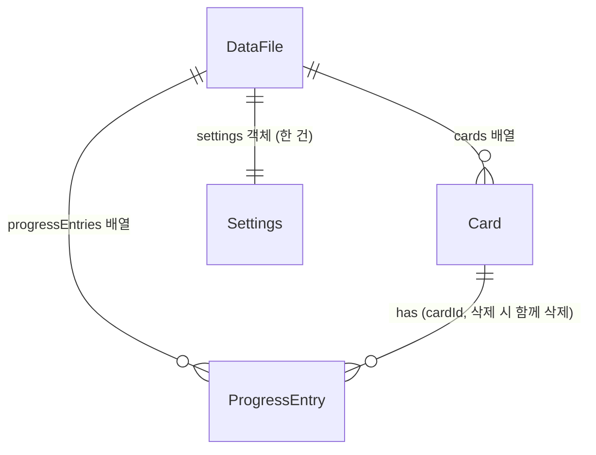

# 데이터 모델 (논리 설계)

> 작성일: 2026-11-03
> 입력: docs/04-spec/spec.md (v4) 데이터 모델(개념, Settings 포함) + 도메인 규칙 + 상태 전이, docs/05-design/01-tech-stack.md (후보 A: Electron + React + TypeScript, 저장은 앱 데이터 폴더의 JSON 파일 1개. Electron은 CON-002로 확정)
> 추상화: 논리 스키마 (마이그레이션 코드와 파일 입출력 구현은 구현 단계). 타입 표기는 TypeScript 기준이다.

서버와 DB가 없다 (CON-001). 모든 데이터는 앱 데이터 폴더의 JSON 파일 하나에 들어 있고, 앱이 켜져 있는 동안 main 프로세스의 메모리에 한 벌을 들고 있다. 이 문서는 그 파일의 구조, 엔티티별 필드와 제약, 저장 절차, 스키마 버전 변환을 정한다. 이 데이터를 다루는 인터페이스는 `03-api-spec.md`가 정한다.

## ERD



- `Card`, `ProgressEntry`, `Settings`가 명세의 엔티티 세 개다. `Card`와 `ProgressEntry`의 관계는 1:N이고 `ProgressEntry.cardId`가 외래키다. `Settings`는 다른 엔티티와 관계가 없고 앱 하나에 한 건이다 (명세: 앱 하나에 한 건).
- `DataFile`은 도메인 엔티티가 아니라 저장 파일의 루트 문서다 (`schemaVersion`, 두 배열, `settings` 객체 하나를 가진다). 파일 하나가 곧 저장소이므로 ERD에 함께 그렸다.
- `Settings`는 카드·기록과 같은 파일의 `settings` 필드에 둔다 (이유는 `설계 메모`의 "설정을 같은 파일에 둔 이유").
- 진행 기록은 카드 안에 중첩하지 않고 최상위 배열에 둔다. 명세의 개념 모델(cardId로 연결)과 같은 모양을 유지하고, 나중에 기록을 카드와 별개로 다룰 때 파일 구조를 덜 바꾸기 위해서다.
- 칸(상태)과 보관은 엔티티가 아니다. 칸은 `Card.status`의 값 세 개로 고정이고 (ASM-002), 보관은 `Card.archivedAt` 표시다.

## 엔티티 상세

### DataFile (저장 문서 루트)

- 설명: 저장 파일 한 개의 최상위 객체. 파일 전체를 읽어 검증하고, 저장할 때마다 전체를 다시 쓴다.
- 관련 FR: FR-006, FR-014 (`settings`)

| 필드 | 타입 | 제약 | 설명 |
|------|------|------|------|
| schemaVersion | integer | NOT NULL, 1 이상 | 이 파일의 스키마 버전. 현재 앱이 쓰는 값은 2다. 버전 변환 기준 (NFR-003) |
| cards | Card[] | NOT NULL, 빈 배열 가능 | 카드 목록. 배열 순서는 만든 순서다 (새 카드는 맨 뒤에 붙는다) |
| progressEntries | ProgressEntry[] | NOT NULL, 빈 배열 가능 | 모든 카드의 진행 기록. 배열 순서는 남긴 순서다 (새 기록은 맨 뒤에 붙는다) |
| settings | Settings | NOT NULL, 객체 한 개 (배열 아님) | 사용자 설정. 스키마 버전 2부터 있다. 버전 1 파일에는 없고 변환이 기본값으로 채운다 (`스키마 버전과 이전 버전 변환`) |

저장 형태 예시 (값은 설명용):

```json
{
  "schemaVersion": 2,
  "settings": { "theme": "dark" },
  "cards": [
    {
      "id": "3f2b8c1e-9d4a-4e7b-8a61-5c0d2e9f7a10",
      "title": "로그인 오류 수정",
      "status": "in_progress",
      "kind": "bug",
      "description": "",
      "dueDate": "2026-11-10",
      "priority": "high",
      "memo": "",
      "archivedAt": null,
      "createdAt": "2026-11-03T09:12:34.567Z"
    }
  ],
  "progressEntries": [
    {
      "id": "a7d1c4b2-0e33-4f58-b9a2-7e6f1d8c3b55",
      "cardId": "3f2b8c1e-9d4a-4e7b-8a61-5c0d2e9f7a10",
      "content": "재현 조건 확인",
      "statusAtTime": "in_progress",
      "createdAt": "2026-11-03T10:00:00.000Z"
    }
  ]
}
```

### Card

- 설명: 개발 버그나 할 일 한 건. 보드, 캘린더, 보관함이 모두 이 엔티티를 보여 준다.
- 관련 FR: FR-001, FR-002, FR-003, FR-004, FR-005, FR-006, FR-007, FR-008, FR-010, FR-011, FR-012, FR-013

| 필드 | 타입 | 제약 | 설명 |
|------|------|------|------|
| id | string (UUID v4) | PK, 불변, DataFile 안에서 유일 | main 프로세스가 만든다. 화면이 값을 정하지 않는다 |
| title | string | NOT NULL, 앞뒤 공백을 뺀 길이 1 이상 | 제목 (ASM-006). 저장할 때 앞뒤 공백을 제거한다 |
| status | enum `todo` \| `in_progress` \| `done` | NOT NULL, 기본 `todo`. 생성 때 허용 값은 `todo` \| `in_progress` 둘뿐이고 `done`은 거부 (AC-042) | 칸. 할 일 / 진행 중 / 완료. 보관은 이 값이 아니다 (AC-004) |
| kind | enum `bug` \| `task` | NOT NULL, 기본 `task` | 종류. 개발 버그 / 할 일 (FR-007, ASM-007). 값 이름을 `task`로 둔 것은 상태 `todo`(할 일 칸)와 헷갈리지 않게 하기 위해서다 |
| description | string | NOT NULL, 기본 `""` | 상세 설명. 비어 있으면 빈 문자열 (FR-008) |
| dueDate | string \| null | 기본 `null`. 값이 있으면 `YYYY-MM-DD` 형식이고 달력에 실제로 있는 날짜 | 마감일. 날짜만 있고 시각과 시간대가 없다 (ASM-005, AC-029). 캘린더에서 끌어 놓아 바꾸는 값도 이 필드 하나뿐이다 (AC-044, ASM-018) |
| priority | enum `high` \| `medium` \| `low` \| null | 기본 `null` | 우선순위. 화면 이름은 없음(`null`) / 낮음(`low`) / 중간(`medium`) / 높음(`high`) 순서 (ASM-008, AC-016). `medium`의 이전 이름은 보통이고 저장 값은 그대로다 |
| memo | string | NOT NULL, 기본 `""` | 추가 메모 (FR-008) |
| archivedAt | string \| null | 기본 `null`. 값이 있으면 UTC 시각 문자열이고, 그때 `status`는 반드시 `done` | 보관한 시각. `null`이면 보드와 캘린더에 보이고, 값이 있으면 보관함에서만 보인다 (AC-019, AC-020) |
| createdAt | string | NOT NULL, 불변, UTC 시각 문자열 | 만든 시각. 예: `2026-11-03T09:12:34.567Z` |

- 인덱스: 디스크에는 인덱스가 없다. 앱이 켜질 때 메모리에 `id → Card` 맵을 만든다 (조회·수정·삭제용). 목록 조회는 배열을 한 번 훑는다. 카드가 수백~수천 건이라는 추정(ASM-010)에서는 선형 탐색으로 충분하다 (측정하지 않은 추정).
- 상태 컬럼: `status`(칸)와 `archivedAt`(보관 표시), 두 개. 아래 `상태 전이 매핑` 참고.
- 검증 규칙: 아래 `검증 규칙과 제약 매핑` 참고.
- 읽기 전용 규칙: `archivedAt`이 `null`이 아닌 카드는 수정할 수 없고 기록도 추가할 수 없다 (ASM-015). 삭제는 가능하다: 보관한 카드도 보관함에서 확인 단계 뒤 삭제할 수 있고 그 카드의 진행 기록이 함께 삭제된다 (AC-040, UC-009. 사용자가 정했다).
- 정렬: 저장 순서는 만든 순서뿐이다. 칸 안에서 어떤 순서로 보여 줄지는 정해지지 않았다 (CAND-005, `결정 필요`). 우선순위의 화면 표시 순서(없음, 낮음, 중간, 높음)는 선택 목록의 순서이고 카드 정렬 규칙이 아니다.

### ProgressEntry

- 설명: 카드에 사용자가 직접 남긴 진행 기록 한 건 (추가 이슈, 검토사항). 자동으로 쌓이는 이력이 아니다 (ASM-009).
- 관련 FR: FR-009, FR-011 (AC-034)

| 필드 | 타입 | 제약 | 설명 |
|------|------|------|------|
| id | string (UUID v4) | PK, 불변, 유일 | main 프로세스가 만든다 |
| cardId | string | NOT NULL, FK → Card.id (참조 대상이 반드시 존재) | 어느 카드의 기록인가. 카드가 삭제되면 같은 저장에서 함께 삭제한다 (AC-034) |
| content | string | NOT NULL, 앞뒤 공백을 뺀 길이 1 이상 | 기록 내용. 빈 기록은 추가하지 않는다. 저장할 때 앞뒤 공백을 제거한다 |
| statusAtTime | enum `todo` \| `in_progress` \| `done` | NOT NULL, 불변 | 기록을 남긴 때의 카드 상태. main 프로세스가 그 순간의 `Card.status`를 읽어 넣고, 화면이 값을 정하지 못한다 (AC-018). 카드를 진행 중으로 만들어도 이 값이나 기록이 생기지 않는다: 기록은 `progress.add` 때만 만들어진다 |
| createdAt | string | NOT NULL, 불변, UTC 시각 문자열 | 기록을 남긴 시각 |

- 인덱스: 앱이 켜질 때 `cardId → ProgressEntry[]` 맵을 메모리에 만든다 (카드 열기, 카드 삭제 때 해당 카드의 기록 찾기). 맵 안의 순서는 배열(남긴) 순서다.
- 상태 컬럼: 없음. 기록은 만든 뒤 바뀌지 않는다 (수정·삭제 기능은 정해지지 않았다, CAND-009).
- 검증 규칙: `content` 비어 있음 불가, `statusAtTime`은 세 값 중 하나, `cardId`는 존재하는 카드.
- 정렬: 남긴 순서(= 배열 순서)로 보여 준다 (AC-017).
- 보관 카드: 보관된 카드에는 기록을 추가할 수 없지만, 이미 있는 기록은 카드와 함께 읽을 수 있다 (AC-020).

### Settings

- 설명: 사용자 설정. 지금은 화면 밝기 판 하나다 (FR-014). 앱 하나에 한 건이라 `id`가 없고, `DataFile.settings` 객체 하나가 곧 이 엔티티다.
- 관련 FR: FR-014 (AC-037, AC-038, AC-039), FR-006 (같은 저장 파일, NFR-002, NFR-003 적용)

| 필드 | 타입 | 제약 | 설명 |
|------|------|------|------|
| theme | enum `dark` \| `light` | NOT NULL, 기본 `light` | 화면 밝기 판. 어두운 판 / 밝은 판. 사용자가 고른 적이 없으면 `light` (밝은 판). 이미 저장된 값은 바꾸지 않는다 (ASM-017, AC-038) |

- 인덱스: 없음 (객체 한 개, 메모리에서 바로 읽는다).
- 상태 컬럼: 없음. 값 두 개 사이에서 어느 방향으로든 바꿀 수 있다.
- 생성과 삭제: 한 건이 항상 있다. 저장 파일이 없는 처음 실행에서는 메모리에 `{ theme: 'light' }`로 만들고, 파일에는 첫 저장(카드 변경이든 판 전환이든) 때 함께 쓰인다. 이전 버전 파일을 읽을 때는 변환이 기본값으로 채운다. 삭제하는 인터페이스는 없다 (명세: 삭제하지 않는다).
- 기본값 변경과 저장된 값 (명세 v4): 기본값은 `dark`에서 `light`로 바뀌었지만 이미 저장된 `settings.theme`는 어떤 값이든 그대로 읽는다. 스키마 변경도 데이터 변환(마이그레이션)도 없다. 기본값은 "저장된 값이 없을 때"에만 쓰인다.
- 검증 규칙: `theme`은 `dark` 또는 `light` 둘 중 하나. 아래 `검증 규칙과 제약 매핑` 참고.
- 저장 실패: 판 전환을 저장하지 못하면 저장소의 `settings`는 바뀌지 않고 파일도 이전 그대로다 (다른 변경과 같다). 이번 실행 동안 바뀐 판으로 보이게 하는 것은 화면 쪽 상태의 일이다 (UC-011 Alt Flow 1, `03-api-spec.md`의 `settings.setTheme`). 다음 실행은 마지막으로 저장에 성공한 판으로 열린다.
- 다른 설정(글자 크기, 언어 등)은 명세에 없어 필드를 만들지 않았다.

## 상태 전이 매핑

명세의 Card 상태 전이를 두 필드로 옮긴다. "보관됨"은 상태 값이 아니라 `status = done` 이면서 `archivedAt ≠ null`인 조합이다.

| 명세의 상태 | status | archivedAt | 가능한 변경 |
|-------------|--------|-----------|------------|
| 할 일 | `todo` | null | status를 `in_progress` / `done`으로, 수정, 기록 추가, 삭제 |
| 진행 중 | `in_progress` | null | status를 `todo` / `done`으로, 수정, 기록 추가, 삭제 |
| 완료 | `done` | null | status를 `todo` / `in_progress`로(되돌리기), 보관, 수정, 기록 추가, 삭제 |
| 보관됨 | `done` | 값 있음 | 삭제만 가능 (확인 단계 뒤 삭제하고 진행 기록도 함께 삭제, AC-040). 수정, status 변경, 기록 추가는 불가 (ASM-015) |

- 카드 만들기의 처음 상태는 할 일(`todo`, 기본) 또는 진행 중(`in_progress`)이고, 완료(`done`)로는 만들 수 없다 (ASM-004, AC-001, AC-041, AC-042). 만들 때 `archivedAt = null`이다. 생성 입력의 `status`가 없으면 `todo`다. 진행 중으로 만들어도 진행 기록(`ProgressEntry`, `statusAtTime`)에는 영향이 없다: 기록은 만들어지지 않고, 이후 `progress.add`가 그 순간의 `Card.status`를 읽는 규칙(AC-018)도 그대로다.
- 세 status 사이에서는 어느 방향으로든 바꿀 수 있다 (ASM-004). 같은 값으로 바꾸면 아무것도 바뀌지 않는다 (UC-002 Alt Flow 1).
- 보관은 `status = done`인 카드에만 한다 (ASM-013, AC-021). `archivedAt`을 `null`로 되돌리는 보관 해제는 정해지지 않아 인터페이스를 만들지 않는다 (CAND-003, `결정 필요`). 데이터 모양은 보관 해제가 생겨도 바뀌지 않는다 (`archivedAt`을 `null`로 되돌리면 된다).
- 보관한 카드가 읽기 전용이라 보관된 카드의 status는 항상 `done`으로 유지된다. 즉 "`archivedAt ≠ null` 이면 `status = done`"이라는 불변식은 모든 인터페이스가 지킨다.

## 검증 규칙과 제약 매핑

명세의 검증 규칙을 저장 데이터의 제약으로 옮기고, 위반했을 때 돌려주는 오류 값을 함께 적는다. 오류 값은 `{ field, reason }` 쌍이고, 여러 개를 동시에 위반하면 모두 모아서 돌려준다 (`03-api-spec.md`의 `VALIDATION_FAILED`). 같은 검증을 (1) 인터페이스 입력 검증과 (2) 파일을 읽은 직후의 구조 검증이 공유한다.

| 대상 | 명세 규칙 | 제약 | 위반 오류 값 (`field` / `reason`) |
|------|----------|------|-----------------------------------|
| title | 비어 있으면 안 된다 (ASM-006, AC-002, AC-035) | 문자열이고 앞뒤 공백 제거 후 길이 1 이상 | `title` / `REQUIRED` (문자열이 아니면 `INVALID_TYPE`) |
| kind | 개발 버그 또는 할 일, 안 고르면 할 일 (ASM-007, AC-014) | `bug` \| `task`. 생성 때 값이 없으면 `task` | `kind` / `INVALID_VALUE` |
| status | 세 값뿐, 보관은 값이 아니다 (AC-004). 카드를 만들 때는 할 일 또는 진행 중만 (AC-042) | 저장된 카드와 수정·상태 변경 입력은 `todo` \| `in_progress` \| `done`. 생성 입력은 `todo` \| `in_progress`만 (없으면 `todo`) | `status` / `INVALID_VALUE` (`archived`를 넣어도, 생성 입력에 `done`을 넣어도 이 오류) |
| priority | 낮음, 중간, 높음 또는 비움 (ASM-008, AC-016) | `high` \| `medium` \| `low` \| `null` | `priority` / `INVALID_VALUE` |
| dueDate | 존재하는 날짜 또는 비움 (ASM-005, AC-029) | `null` 또는 `YYYY-MM-DD` 형식이면서 달력에 실제로 있는 날짜 (윤년 반영. 예: `2026-02-30`은 거부) | `dueDate` / `INVALID_DATE` (문자열이 아니면 `INVALID_TYPE`) |
| description, memo | 선택 (FR-008) | 문자열 (빈 문자열 가능) | `description` 또는 `memo` / `INVALID_TYPE` |
| 진행 기록 content | 내용이 비어 있으면 추가하지 않는다 | 앞뒤 공백 제거 후 길이 1 이상 | `content` / `REQUIRED` |
| theme | 어두운 판 또는 밝은 판, 처음은 밝은 판 (FR-014, ASM-017, AC-038) | `dark` \| `light`. 저장된 값이 없는 처음 실행·이전 버전 파일에서는 `light`. 이미 저장된 값은 바꾸지 않는다 | `theme` / `INVALID_VALUE` (문자열이 아니면 `INVALID_TYPE`) |
| 보관 | 완료 카드만 (ASM-013, AC-021) | `archivedAt ≠ null` 이면 `status = done` | 인터페이스 오류 `ARCHIVE_NOT_ALLOWED` (필드 오류가 아니라 동작 오류) |
| 보관 카드 읽기 전용 | 수정·기록 추가 불가 (ASM-015) | 보관된 카드에는 수정, status 변경, 기록 추가 금지 | 인터페이스 오류 `CARD_ARCHIVED` |
| 삭제 시 기록 | 카드의 기록도 함께 삭제 (AC-034) | `ProgressEntry.cardId`는 항상 존재하는 카드를 가리킨다 | 삭제와 같은 저장에서 처리하므로 위반 상태가 생기지 않는다 |
| 알 수 없는 입력 필드 | - | 인터페이스 입력에 정의되지 않은 필드가 있으면 거부 (`id`, `archivedAt`, `createdAt`을 화면이 정하지 못하게 한다) | 해당 필드 이름 / `UNKNOWN_FIELD` |

- 마감이 지난 카드 판정은 저장하지 않는다. 날짜가 바뀌면 값이 달라지는 파생 값이라서, 필요할 때 `dueDate`, `status`, 오늘 날짜로 계산한다 (`isOverdue`, `03-api-spec.md`). 판정식은 `dueDate ≠ null` 이고 `dueDate < 오늘(PC 현지 날짜)` 이고 `status ≠ done` 이다 (ASM-014, AC-024, AC-025).
- 제목, 설명, 메모, 기록 내용의 길이 상한은 사용자가 말하지 않아 두지 않는다 (`결정 필요`).
- 파일을 읽을 때는 위 제약 외에 다음 구조 불변식도 검사한다: Card.id 중복 없음, ProgressEntry.id 중복 없음, 모든 `cardId`가 존재하는 카드를 가리킴, `archivedAt ≠ null` 이면 `status = done`, 시각 필드가 UTC 시각 문자열 형식, 현재 버전(2) 파일에는 `settings` 객체가 있고 `theme`이 `dark`·`light` 중 하나 (없거나 목록 밖의 값이면 기본값으로 고치지 않고 읽기 실패 `SCHEMA_INVALID`). 하나라도 어기면 읽기 실패로 처리한다 (`저장과 읽기 절차`). 저장된 카드의 `status`는 생성 때의 제한(할 일·진행 중)과 무관하게 세 값 모두 유효하다.

## 저장 파일과 폴더

저장 위치는 Electron의 앱 데이터 폴더(`app.getPath('userData')`)다. 폴더를 어떻게 지정하는지(시험용 임시 폴더 포함)는 아키텍처 설계가 정한다. 파일은 다음과 같다 (모두 UTF-8, BOM 없음, 줄바꿈 LF).

| 파일 | 내용 | 누가 읽나 |
|------|------|----------|
| `kanban-data.json` | 현재 저장본. DataFile 한 개(카드, 진행 기록, 설정)를 2칸 들여쓰기 JSON으로 쓴다 (사람이 열어 볼 수 있게). 설정을 위한 별도 파일은 없다 | 앱이 켜질 때 |
| `kanban-data.json.<프로세스 id>.tmp` | 저장 중 임시 파일. 저장이 끝나면 `kanban-data.json`으로 바뀐다. 이름에 앱 프로세스 id를 붙여, 같은 폴더를 쓰는 다른 실행과 임시 파일이 겹치지 않게 한다 (RK-010). 한 실행 안에서는 이름이 바뀌지 않는다 | 아무도 읽지 않는다. 남아 있어도(비정상 종료로 남은 고아 `.tmp` 포함) 무시한다. 같은 이름은 그 실행의 다음 저장 때 덮어쓴다 |
| `kanban-data.json.bak` | 직전 저장본. 저장할 때마다 교체 직전에 현재 저장본을 복사해 둔다. 직전 저장본이므로 삭제 전 카드 내용이 다음 저장 때까지 남아 있을 수 있다 | 본 파일이 없을 때만 앱이 읽는다. 그 밖에는 사용자가 직접 열어 볼 때 쓴다 |
| `kanban-data.pre-v{N}.json` | 이전 버전(N) 파일을 새 버전으로 처음 저장하기 직전의 원본 사본 (버전 변환 안전장치, 없을 때만 만든다). 만든 뒤 지우지 않으므로 그 시점의 삭제 전 카드 내용이 남아 있을 수 있다 | 아무도 읽지 않는다. 사용자가 직접 열어 볼 때 쓴다. 사용자가 지워도 되는 임시 안전장치다 |

앱은 이 폴더 밖에는 쓰지 않고, 파일을 지우는 일은 같은 이름의 `.tmp`를 덮어쓰는 것뿐이다 (다른 프로세스 id의 고아 `.tmp`는 앱이 지우지 않는다). 읽지 못한 본 파일은 어떤 경우에도 지우거나 덮어쓰지 않는다.

> 삭제 전 내용이 남는 곳 (RK-009): 카드를 삭제하면 보드와 `kanban-data.json`에서는 사라지지만(AC-023), 직전 저장본(`.bak`)과 버전 변환 사본(`pre-v{N}.json`)에는 삭제 전 내용이 남을 수 있다. 이 파일들은 앱이 지우지 않는다. 이 사실은 삭제 확인 문구가 아니라 이 문서와 README의 안내로 둔다.

## 저장과 읽기 절차

### 저장 (NFR-002, AC-031)

모든 변경은 "새 문서를 만들고 → 디스크에 쓰고 → 성공하면 메모리에 반영"하는 한 번의 트랜잭션이다. 변경 요청은 한 줄로 세워 한 번에 하나씩 처리한다 (동시에 두 변경이 파일을 쓰지 않는다). 설정 변경(판 전환)도 카드·기록 변경과 같은 줄, 같은 절차를 쓴다. 설정만 따로 쓰는 경로는 없다 (NFR-002가 설정에도 그대로 적용된다). 캘린더에서 끌어 마감일을 바꾸는 변경(AC-044)도 `cards.update` 한 번이라 같은 절차다.

1. 변경을 적용한 새 DataFile 문서를 메모리에 만든다 (현재 상태는 건드리지 않는다). 도메인 규칙과 구조 불변식을 먼저 검사한다.
2. 문서를 JSON 문자열로 만들어 임시 파일(`kanban-data.json.<프로세스 id>.tmp`)에 쓰고, 파일을 디스크에 반영(fsync)한 뒤 닫는다. 같은 이름의 `.tmp`가 이미 있으면 덮어쓴다. (단계 이름 `write_temp`. 쓰기와 fsync는 `FileSystemPort.writeFileSynced` 한 호출이라 별도 단계로 나누지 않고, 디스크 반영 실패도 `write_temp`로 보고한다. 저장 단계 이름은 `write_temp`, `verify`, `backup`, `replace` 네 가지다)
3. `.tmp`를 다시 읽어 파싱하고 같은 검증을 통과하는지 확인한다. (`verify`) 직렬화 오류가 본 파일로 번지는 것을 막는다.
4. 본 파일이 있으면 `kanban-data.json`을 `kanban-data.json.bak`로 복사한다 (기존 `.bak` 덮어씀). 이 단계가 실패하면 저장 전체를 실패로 처리한다. 직전 저장본을 못 남기는 채로 본 파일을 바꾸지 않기 위해서다. (`backup`) 첫 저장이라 본 파일이 없으면 건너뛴다.
5. `.tmp`를 `kanban-data.json`으로 이름 바꿔 교체한다 (같은 폴더 안의 이름 바꾸기이며 덮어쓰기 허용). 본 파일이 사라진 순간이 생기지 않는 방식으로 구현한다. (`replace`) Windows에서 백신·검색 색인·클라우드 동기화가 대상 파일을 잠깐 잡으면 이름 바꾸기가 `EPERM`/`EBUSY`/`EACCES`로 간헐 실패할 수 있으므로, 파일 시스템 구현(`NodeFileSystem.rename`) 안에서만 이 세 코드에 한해 20~50ms 간격으로 최대 3~5회 다시 시도한다. 모두 실패하면 그 오류로 `SAVE_FAILED`(stage `replace`)다. `FileSystemPort` 인터페이스와 이 절차의 단계는 바뀌지 않는다 (RK-013, FE-015. 정확한 간격과 횟수는 구현 첫 Task에서 확인한다).
6. 교체가 끝난 뒤에만 메모리 상태를 새 문서로 바꾸고 호출자에게 성공을 돌려준다. 화면의 "저장 완료" 표시는 이 성공을 받은 뒤에 한다.

- 단계 2~5 어디서든 실패하면 메모리 상태는 바뀌지 않고, 본 파일도 이전 저장본 그대로다. 호출자는 `SAVE_FAILED`를 받고 (실패 단계 `stage`와 OS 오류 코드 포함), 화면은 입력한 내용을 지우지 않는다 (AC-031). 칸 이동·보관·삭제·캘린더 끌기는 화면이 저장 성공을 받은 뒤에만 바뀌므로 실패하면 화면도 저장소와 같은 이전 상태 그대로이고 사용자가 다시 시도한다 (AC-046). 판 전환 저장이 실패했을 때도 저장소와 파일은 그대로이고, 화면이 이번 실행 동안만 바뀐 판을 유지하며 저장 실패를 알린다 (UC-011 Alt Flow 1).
- 설정과 카드가 한 문서라서 설정을 바꾸는 저장도 카드·기록을 포함한 전체를 다시 쓴다. 한 번의 교체로 설정과 카드가 함께 바뀌거나 함께 그대로이므로 둘이 서로 다른 시점이 되는 중간 상태가 없다.
- 앱을 정상 종료할 때는 줄 서 있는 저장이 모두 끝난 뒤에 닫는다. 그래서 정상 종료 직전의 변경도 잃지 않는다.
- 프로세스를 강제 종료했을 때 디스크 상태와 다음 실행:

| 중단된 시점 | 디스크 상태 | 다음 실행에서 |
|-------------|-----------|--------------|
| 단계 2 (임시 파일 쓰는 중, 디스크 반영 포함) | 본 파일 = 직전 저장본, `.tmp` 일부만 있음 | 본 파일 = 직전 저장본으로 열린다. `.tmp`는 무시 |
| 단계 3 직후 (`.tmp` 완성, 교체 전) | 본 파일 = 직전 저장본 | 직전 저장본으로 열린다. 이 저장은 아직 "완료"가 표시되지 않았으므로 정상 |
| 단계 4 (백업 복사 중) | 본 파일 = 직전 저장본, `.bak`은 일부만 있을 수 있음 | 직전 저장본으로 열린다. 불완전한 `.bak`은 읽지 않는다 |
| 단계 5 (교체 중) | 이름 바꾸기는 한 번에 일어나므로 본 파일 = 직전 저장본 또는 새 저장본 | 둘 중 하나로 열린다. 반쪽짜리 파일은 없다 |
| 단계 5 중에 본 파일이 없어진 경우 (파일 시스템이 교체를 둘로 쪼갠다면) | 본 파일 없음, `.bak` = 직전 저장본 | `.bak`이 검증을 통과하면 그것으로 열고 `recoveredFromBackup = true`를 알린다 |
| 단계 6 이후 | 본 파일 = 새 저장본 | 새 저장본으로 열린다 |

- 전원이 갑자기 꺼지는 경우는 이 절차가 보장하는 범위 밖일 수 있다. Windows에는 폴더 항목을 디스크에 강제로 반영하는 방법이 없어서, 교체 직후 전원이 꺼지면 마지막 저장이 되돌아갈 수 있다 (추정, 이번에 실험하지 않음). NFR-002는 "프로세스를 강제 종료"한 경우를 요구하므로 요구 범위 안은 아니다.

### 읽기 (앱이 켜질 때, AC-011, AC-032)

1. 본 파일 `kanban-data.json`이 있으면 읽는다.
   - 읽기 오류, JSON 파싱 오류(빈 파일 포함), 구조 검증 실패, 버전이 더 새로움, 버전 변환 실패 중 하나면 **읽기 실패**다.
   - 모두 통과하면 그 문서를 메모리에 올리고 정상 시작한다.
2. 본 파일이 없을 때:
   - `.bak`도 없으면 처음 실행이다 → 빈 보드와 기본 설정(`theme = light`)으로 시작한다 (UC-005 Alt Flow 2, ASM-017). `.tmp`만 있는 경우도 처음 실행으로 본다 (완료 표시가 나간 저장이 없다).
   - `.bak`이 있고 검증을 통과하면 그것으로 시작한다 (`recoveredFromBackup = true`).
   - `.bak`이 있는데 검증을 통과하지 못하면 **읽기 실패**다.
3. **읽기 실패의 처리 (AC-032)**: 저장소를 "읽기 실패" 상태로 둔다. 이 상태에서는
   - 빈 보드를 만들지 않고 `getStatus`가 실패 원인을 돌려준다. 화면은 빈 보드와 구분되는 오류 안내를 보인다. 설정도 같은 파일이라 읽을 수 없고, 저장된 판을 알 수 없다 (`결정 필요`의 "읽기 실패 화면의 판").
   - 모든 목록·조회·변경 요청(설정 조회·전환 포함)은 `STORE_LOCKED`로 거절한다. 어떤 저장도 하지 않으므로 읽지 못한 본 파일은 덮어쓰이지 않는다.
   - 본 파일, `.bak`, `.tmp`는 건드리지 않는다. 오류 정보(`ReadFailure`)에는 읽지 못한 파일의 경로, 직전 저장본(`.bak`)의 경로와 상태(`absent` / `valid` / `invalid`), 버전 변환 전 사본(`pre-v{N}.json`)의 경로와 있는지 여부를 담아 화면이 보여 줄 수 있게 한다 (RK-003, DC-003).
   - 읽기 실패에서 벗어나는 방법: 앱 안에 복구 동작(직전 저장본으로 열기, 손상 파일을 보존하고 새로 시작하기)을 넣지 않기로 사용자가 정했다 (D3). 앱이 하는 것은 `retryOpen`(다시 읽기)과 안내 문구뿐이다. 안내 문구는 사용자가 앱을 닫고 폴더에서 직접 하는 수동 절차를 보여 준다. 예: 직전 저장본이 `valid`이면 `앱을 닫고 폴더에서 kanban-data.json을 다른 이름으로 바꾸면 직전 저장본으로 열린다` (본 파일이 없을 때 `.bak`으로 여는 위 2번 규칙을 사용자가 만든다). 앱은 이 절차를 대신 실행하지 않고 파일을 지우거나 쓰지 않는다.
4. 본 파일이 읽혔지만 `.bak`이 깨져 있어도 시작은 정상이다. 다음 저장이 `.bak`을 새로 만든다.

읽기 실패 원인 값 (`ReadFailure.code`. 화면에는 코드를 문구로 바꾸고 OS 오류 코드가 있으면 함께 보여 준다):

| 값 | 상황 |
|----|------|
| `FILE_UNREADABLE` | 파일 시스템 오류 (권한, 잠금, 입출력 오류 등). OS 오류 코드를 함께 알림 |
| `JSON_PARSE_FAILED` | JSON이 아니거나 중간에 잘림, 빈 파일 |
| `SCHEMA_INVALID` | 최상위 모양이 틀림, `schemaVersion`이 없거나 정수가 아님, 필드 타입·값이 제약 위반 (현재 버전 파일의 `settings` 누락·`theme` 값 오류 포함), 위반 위치 몇 곳을 알림 |
| `INTEGRITY_VIOLATED` | 아이디 중복, 존재하지 않는 카드를 가리키는 기록, 보관됐는데 완료가 아닌 카드 |
| `SCHEMA_TOO_NEW` | 파일의 `schemaVersion`이 이 앱이 아는 최대 버전보다 크다 (더 새로운 앱이 저장한 파일). 낮춰서 읽거나 쓰지 않는다 |
| `MIGRATION_FAILED` | 이전 버전 변환 중 오류 |

## 스키마 버전과 이전 버전 변환 (NFR-003)

- 파일 최상위의 `schemaVersion`이 그 파일의 구조 버전이다. 앱은 `CURRENT_SCHEMA_VERSION`(지금 2)과 "버전 N 문서를 N+1 문서로 바꾸는 함수" 표를 가진다. 설정은 카드·기록과 같은 문서라서 이 버전 하나와 변환 사슬이 설정에도 그대로 적용된다 (NFR-003).
- 명세 v4의 변경(생성 시 상태 선택, 우선순위 이름, 기본 판)은 저장 형식을 바꾸지 않는다. 저장 필드·값 이름·구조가 그대로라서 `schemaVersion`은 2로 두고 새 변환 함수를 만들지 않는다.
- 읽을 때 순서: JSON 파싱 → `schemaVersion` 확인 → (현재 버전보다 낮으면) N→N+1 변환을 현재 버전까지 차례로 적용 → 현재 버전 구조 검증 → 메모리에 올림. 모든 이전 버전은 이 변환 사슬로 읽힌다 (이전 버전에서 저장한 카드·기록 100% 읽힘, 설정 없는 파일도 기본값으로 열림).
- 변환은 메모리에서만 일어난다. 앱을 켜기만 해서는 파일을 바꾸지 않는다. 변환된 문서는 사용자의 첫 변경 저장 때 새 버전으로 쓰이고, 그 직전에 변환 전 원본을 `kanban-data.pre-v{N}.json`으로 한 번 복사해 둔다 (이미 있으면 만들지 않는다). 변환 코드의 오류로 데이터가 잘못 바뀌었을 때 원본이 남는다.
- 변환이나 변환 뒤 검증이 실패하면 `MIGRATION_FAILED`(또는 `SCHEMA_INVALID`)로 읽기 실패 처리한다. 원본은 그대로다.
- 현재보다 높은 버전은 읽지 않고 `SCHEMA_TOO_NEW`로 읽기 실패 처리한다. 더 새로운 앱이 쓴 파일을 이 앱이 일부만 이해한 채 덮어쓰는 것을 막는다.
- 변환 규칙: 필드 추가는 기본값을 채우고, 필드 이름이나 뜻을 바꾸면 변환 함수를 쓴다. 한 번 배포한 버전의 변환 함수는 지우지 않는다. 버전을 올리는 변경에는 "이전 버전 파일 → 새 버전" 시험 데이터를 함께 둔다.

| schemaVersion | 내용 | 이전 버전에서의 변환 |
|---------------|------|---------------------|
| 1 | Card, ProgressEntry 두 배열과 `schemaVersion`. `settings` 없음 (Settings가 명세에 들어오기 전의 구조) | 없음 (첫 버전) |
| 2 | 버전 1 + `settings` 객체 (`theme`) | 1 → 2: `settings = { theme: 'light' }`(기본값, 명세 v4 이후)를 추가하고 `schemaVersion`을 2로. `cards`, `progressEntries`는 그대로 |

설정이 없는 이전 버전 파일을 읽을 때의 기본값 규칙:

- 버전 1 파일(`settings` 없음)은 1→2 변환이 기본값 `theme = light`를 채운다. 사용자가 판을 고른 적이 없는 파일이므로 처음 실행과 같은 기본값이다 (ASM-017, AC-038). 명세 v4 이전 설계는 이 기본값을 `dark`로 정했었다 (`결정 필요`의 "버전 1 파일의 기본 판").
- 변환은 메모리에서만 일어나고 앱을 켜기만 해서는 파일을 바꾸지 않는다. 사용자의 첫 변경 저장 때 `settings`가 포함된 버전 2로 쓰이고, 그 직전에 변환 전 원본이 `kanban-data.pre-v1.json`으로 남는다.
- 기본값은 "버전이 낮아서 `settings`가 없는 파일"에만 채운다. 현재 버전(2) 파일에 `settings`가 없거나 `theme`이 `dark`·`light`가 아닌 값이면 몰래 기본값으로 고치지 않고 읽기 실패(`SCHEMA_INVALID`)로 둔다 (`설계 메모`의 "읽을 때 엄격하게"와 같은 원칙).
- 이미 `settings.theme`가 저장된 버전 2 파일은 값이 `dark`이든 `light`이든 그대로 읽는다. 기본값이 바뀐 것을 이유로 저장된 값을 `light`로 고치지 않는다 (마이그레이션 없음, ASM-017, AC-038).
- 저장 파일이 아예 없는 처음 실행은 변환이 아니라 메모리에서 기본 설정을 만든다 (`Settings`의 생성과 삭제).
- 버전 1은 아직 배포 전일 수 있다 (구현 전). 그래도 변환 함수와 "버전 1 파일 → 버전 2" 시험 데이터는 만든다. 이 규칙을 시험으로 고정하기 위해서다.

버전을 올리게 될 것으로 보이는 미정 사항: 칸 안 직접 정렬(CAND-005, `Card`에 순서 필드 추가), 자동 이력(Q-002, 이력 엔티티 추가). 정해지면 버전 3으로 올리고 변환 함수를 추가한다. 지금은 만들지 않는다.

## 데이터 양 / 보존

| 엔티티 | 추정 (ASM-010) | 보존 정책 |
|--------|---------------|----------|
| Card | 1년에 수백~수천 건. 카드 하나가 평균 1KB 안팎이라고 보면 수 MB 이하 (측정하지 않은 추정) | 사용자가 삭제하기 전까지 영구. 삭제하면 되돌릴 수 없다. 보관한 카드도 삭제하기 전까지 남는다 |
| ProgressEntry | 1년에 수백~수천 건. 수백 KB 이하 (추정) | 카드와 함께 (카드 삭제 시 함께 삭제, AC-034) |
| Settings | 항상 1건. 값 한 개(`theme`)라 수십 바이트 | 삭제하지 않는다. 사용자가 바꾸기 전까지 마지막 저장 값 유지 |
| 파일 | 저장할 때마다 전체를 다시 쓴다. 본 파일 + `.bak` 두 벌이 상시 존재한다 | 백업·내보내기 기능은 없다 (범위 제외). `.bak`은 저장 실패 대비용 직전 저장본일 뿐 사용자 백업 기능이 아니다 |

- 파일이 수십 MB로 커지면 매번 전체를 쓰는 비용이 문제가 될 수 있고, 그때 SQLite를 검토한다는 방침이 `01-tech-stack.md`에 있다. 이번 설계의 규모에서는 해당하지 않는다.
- 검색·필터(FR-013)는 메모리의 배열을 훑는다. 성능 기준은 사용자가 말하지 않았다 (CAND-002).

## 설계 메모

- **JSON 파일 1개**: 사용자가 후보 A(저장은 앱 데이터 폴더의 JSON 파일 1개 구성 포함)를 골랐다. 그래서 테이블, 인덱스, 마이그레이션 SQL이 없고, 위 스키마 버전 변환이 그 역할을 한다.
- **새 엔티티 없음**: 명세의 세 엔티티(Card, ProgressEntry, Settings)만 쓴다. `DataFile`은 파일 루트이고 도메인 엔티티가 아니다. 자동 이력(ASM-009)용 엔티티는 만들지 않았다.
- **설정을 같은 파일에 둔 이유** (명세가 "카드와 같은 저장소인지 따로인지는 설계가 정한다"고 남긴 것): `DataFile.settings`로 두었다.
  - NFR-002(임시 파일 쓰기 후 교체)와 NFR-003(스키마 버전과 변환)을 새로 만들 필요 없이 같은 절차 하나로 받는다. 별도 파일이면 임시 파일·`.bak`·`.pre-v`·강제 종료 시점별 상태·버전 변환·읽기 실패를 한 벌 더 설계하고 시험해야 한다.
  - 파일이 둘이면 "카드는 새 저장본인데 설정은 옛 저장본" 같은 어긋난 상태가 가능해진다. 한 문서의 한 번 교체이면 생기지 않는다.
  - 설정은 값 한 개라 전체를 다시 쓰는 비용은 사실상 늘지 않는다 (판 전환은 드물다).
  - 대가: 데이터 파일이 읽기 실패이면 설정도 읽지 못한다 (`결정 필요`의 "읽기 실패 화면의 판"). 판 전환을 저장하려고 카드·기록 전체를 다시 쓴다.
- **스키마 버전 2**: `settings`를 `DataFile`에 더하는 것은 파일 구조 변경이라 `schemaVersion`을 1에서 2로 올리고 1→2 변환을 둔다. "필드 추가는 기본값을 채운다"는 기존 변환 규칙을 그대로 적용한 것이다. 이 버전 번호 결정은 설계가 한 것이고 명세가 정한 것이 아니다.
- **명세 v4 반영과 스키마 버전 유지**: v4의 세 변경은 모두 저장 형식을 바꾸지 않아 `schemaVersion`을 올리지 않는다. (1) 생성 때 상태 선택은 입력 검증만 바뀌고 `Card.status`의 값 집합은 그대로다. (2) 우선순위 `medium`의 화면 이름만 보통에서 중간으로 바뀌었다. 저장 값이 같아 데이터 변환이 없다. (3) 기본 판은 "저장된 값이 없을 때"의 기본값만 `dark`에서 `light`로 바뀌었다. 이미 저장된 `settings.theme`는 읽을 때 그대로 둔다.
- **이전 실행이 남긴 `dark`**: 기본값이 `dark`였던 앱은 사용자가 판을 고르지 않아도 첫 저장 때 `settings = { theme: 'dark' }`를 파일에 썼다. 그런 파일은 이제 "저장된 선택"으로 읽혀 계속 어두운 판으로 열린다. 사용자가 고른 것인지 기본값이 쓰인 것인지 파일에서 구분할 수 없고, 명세 v4가 "이미 저장된 선택은 바꾸지 않는다"고 했으므로 그대로 둔다.
- **우선순위 순서와 `PRIORITIES` 배열**: 화면 표시 순서는 없음, 낮음, 중간, 높음이다 (AC-016, AC-047). 저장 값 배열 `PRIORITIES`(구현에서는 `['high', 'medium', 'low']`)의 순서는 데이터 의미가 없다. 설계 어디에서도 우선순위로 정렬하지 않고 (CAND-005는 정렬 정책 없음), 검증은 목록에 들어 있는지만 보며, 저장 파일에도 순서가 남지 않는다. 그래서 배열 순서를 바꿔도 데이터·스키마에는 영향이 없다. 영향은 이 배열을 `map`으로 펼쳐 선택 목록을 만드는 화면 코드에만 있다. 화면이 이 배열의 순서를 표시 순서로 쓰지 않고 별도의 표시 순서(낮음, 중간, 높음)를 갖든, 배열 순서를 낮음, 중간, 높음으로 바꾸든 구현이 정한다.
- **판 선택 저장 실패와 저장소 상태**: 저장소는 "마지막으로 저장에 성공한 값"만 들고 있다는 규칙을 설정에도 예외 없이 지킨다. UC-011 Alt Flow 1의 "이번 실행 동안은 바뀐 판"은 화면 상태가 맡는다 (`03-api-spec.md`). 이렇게 하면 이후 카드 저장이 실패한 판 전환을 몰래 함께 저장하는 일이 없다.
- **기본값 표현**: 설명과 메모는 `null`이 아니라 빈 문자열이 "없음"이다. 마감일과 우선순위는 `null`이 "없음"이다. 화면이 없음/빈 값을 하나의 방식으로 다루도록 한 선택이고, 명세의 선택 속성과 충돌하지 않는다.
- **값 이름**: 저장 값(`todo`, `in_progress`, `done`, `bug`, `task`, `high`, `medium`, `low`, `dark`, `light`)은 영문 식별자이고, 화면 문구(할 일, 진행 중, 완료, 낮음, 중간, 높음 등)는 UI 설계가 정한다 (ASM-016).
- **앞뒤 공백 제거**: 제목과 기록 내용에서 앞뒤 공백을 제거한다. 공백만 입력한 제목은 "비어 있음"으로 본다. 명세는 "비어 있으면"만 말해 공백 처리는 구현 세부로 정했다.
- **읽을 때 엄격하게**: 읽은 데이터에서 불변식 위반을 발견하면 조용히 고치거나 버리지 않고 읽기 실패로 둔다. 데이터를 몰래 바꾸지 않는다는 AC-032의 취지에 맞춘 선택이다. 대가는 사소한 불일치로도 앱이 보드를 열지 못할 수 있다는 점이다.
- **기록은 최상위 배열**: 위 ERD 설명 참고. 카드 삭제 때 카드와 기록을 한 번에 지우는 것이 한 번의 저장(원자적 교체)이라서, 두 배열 사이에 중간 상태가 디스크에 남지 않는다.
- **오프라인**: 저장·읽기 어디에도 네트워크가 쓰이지 않는다 (NFR-001). 이 모델에는 URL이나 원격 참조 필드가 없다.
- **접근성**: NFR-004(색 외 구분)는 화면의 문제이고 데이터 필드를 추가하지 않는다. 구분에 쓰는 값은 `kind`와 파생 값(마감 지난 여부)뿐이다. 이 값들은 `theme`과 무관하게 같으므로 어두운 판과 밝은 판 모두에서 같은 구분이 가능하다 (AC-039). `theme`은 구분 방식을 바꾸는 필드가 아니다.

## 결정 필요

사용자가 말하지 않은 정책이라 만들지 않았다. 아래 항목이 정해지기 전까지는 표의 "지금 설계"대로 동작한다.

| 항목 | 지금 설계 | 선택지 | 권고 |
|------|----------|--------|------|
| 칸 안 카드 정렬 (CAND-005) | 정렬 정책 없음. 저장은 만든 순서를 유지하고 `createdAt`을 가진다. 목록 조회는 이 저장 순서로 돌려주며, 이것은 보여 주는 순서를 정한 것이 아니다 | (a) 만든 순서 (b) 마감일 순 (c) 우선순위 순 (d) 직접 정렬 | 사용자가 정하기 전에는 (a). (d)를 고르면 `Card`에 순서 필드를 더하고 스키마를 버전 3으로 올린다 |
| 보관 해제 (CAND-003) | 보관 해제 인터페이스를 만들지 않았다. 보관한 카드는 삭제만 가능하다 | (a) 해제 없음 (b) 해제 허용 (`archivedAt`을 `null`로) | 사용자가 정한다. (b)여도 데이터 모양은 바뀌지 않고 인터페이스만 추가한다 |
| 자동 이력 (Q-002, ASM-009) | 자동 이력 엔티티 없음. 진행 기록은 사용자가 직접 적은 글만이다 | (a) 직접 기록만 (b) 상태 변경 등을 자동으로 남기는 이력 추가 | 사용자가 정한다. (b)면 새 엔티티와 스키마 버전 3이 필요하다 (저장 방식의 SQLite 전환도 함께 검토) |
| 진행 기록 수정·삭제 (CAND-009) | 추가와 조회만 있다. 기록 단독 수정·삭제는 만들지 않았다 (카드 삭제 때 함께 삭제만) | (a) 추가만 (b) 수정·삭제 허용 | 사용자가 정한다 |
| 읽기 실패 화면의 판 (FR-014) | 데이터 파일이 읽기 실패이면 설정도 읽지 못한다. 화면은 기본값(밝은 판)으로 오류 안내를 보이고, 이 상태의 판 전환은 `STORE_LOCKED`로 거절된다 (저장하지 않으므로 파일을 덮어쓰지 않는다) | (a) 지금 그대로 (b) 설정을 별도 파일로 분리해 읽기 실패에서도 저장된 판을 쓴다 (그러면 설정에도 임시 파일·`.bak`·버전 변환을 한 벌 더 설계한다) | 사용자가 정한다. 사용자가 말하지 않았고 오류 안내 화면에서의 판은 영향이 작아 (a)로 둔다 |
| 읽기 실패에서 벗어나는 방법 | 해소됨 (사용자 결정 D3): 앱 안에 복구 동작을 넣지 않는다. `retryOpen`(다시 읽기)과, 읽지 못한 파일 경로·직전 저장본(`.bak`)과 버전 변환 전 사본의 경로·상태·수동 절차를 보여 주는 안내 문구만 둔다. 앱이 파일을 지우거나 쓰지 않는다 | (a) 지금 그대로(안내 문구 보강) (b) "직전 저장본으로 열기" 동작 추가 (c) "손상 파일을 옆으로 옮겨 보존하고 빈 보드로 시작" 동작 추가 | 사용자가 (a)를 골랐다. (b), (c)는 사용자가 나중에 원하면 새 요구로 다룬다 |
| 필드 길이 상한 | 제목, 설명, 메모, 기록 내용에 상한이 없다 | (a) 상한 없음 (b) 상한을 둔다 | 사용자가 말한 값이 없어 (a). 매우 큰 입력은 파일 크기와 전체 다시 쓰기 시간에만 영향을 준다 |
| 버전 1 파일의 기본 판 (ASM-017, AC-038) | 명세 v4가 "저장된 선택이 없을 때는 밝은 판"이라 했으므로, 설정이 없는 버전 1 파일의 1→2 변환도 `light`를 채운다. 명세는 버전 1 파일을 따로 말하지 않았고 이 해석은 설계가 한 것이다 | (a) `light` (b) 이전 설계대로 `dark` | 사용자가 정한다. 버전 1 파일은 배포된 적이 없을 수 있어 영향이 작고, 처음 실행과 같은 기본값이 일관되어 (a)로 둔다 |

## 검증 기록

- 설계 결함 수정(BI-003, 구현 중 보고): 저장 단계에서 `sync`를 따로 두지 않고 `write_temp`에 포함해 `write_temp`, `verify`, `backup`, `replace` 네 단계로 고쳤다(`writeFileSynced` 한 호출이 쓰기와 fsync를 함께 한다). 저장 단계 수만 5에서 4로 바뀌었고 파일·컴포넌트·Wave·TC·인터페이스 수는 그대로다.
- 2026-11-05 명세 v4 반영(AC-041~AC-048, ASM-004/008/017/018): `Card.status`의 생성 때 허용 값을 `todo`·`in_progress`로 제한(생성 입력의 `done`은 `status` / `INVALID_VALUE`), 우선순위 화면 이름 보통→중간과 표시 순서(없음, 낮음, 중간, 높음), `Settings.theme` 기본값 `dark`→`light`(처음 실행·버전 1 파일의 1→2 변환), 캘린더 끌기가 `dueDate`만 바꾼다는 점을 반영했다. 저장 형식이 같아 `schemaVersion`은 2 그대로이고, 이미 저장된 `settings.theme`는 바꾸지 않는다(마이그레이션 없음). 진행 중으로 만들어도 `ProgressEntry`/`statusAtTime`에는 영향이 없다. 아래 기록 중 "어두운 판"이 기본이라는 서술은 이 수정 전의 것이며 지금은 밝은 판이 기본이다.
- 명세(v4)의 엔티티 세 개(Card, ProgressEntry, Settings)와 필수·선택 속성이 모두 필드로 옮겨졌다. 속성 이름은 명세의 `id, title, status, kind, createdAt, description, dueDate, priority, memo, archivedAt`, `id, cardId, content, statusAtTime, createdAt`, `theme`과 같다. Settings의 기본값(밝은 판)과 "앱 하나에 한 건"도 반영했다.
- 각 엔티티에 관련 FR이 있다: Card (FR-001~FR-008, FR-010~FR-013), ProgressEntry (FR-009, FR-011), Settings (FR-014), DataFile (FR-006, FR-014). FR-001~FR-014를 이 모델이 담는다.
- 상태 전이: 보관은 `status`가 아니라 `archivedAt`이고 `status`는 `done`으로 남는다 (AC-004). 보관은 완료 카드만, 보관 카드는 읽기 전용(ASM-013, ASM-015)이다.
- 도메인 규칙: 마감이 지난 판정(ASM-014)은 파생 값으로 정의했고, 검증 규칙 여덟 가지(제목, 종류, 상태, 우선순위, 마감일, 진행 기록, 보관, 화면 밝기 판)는 모두 제약과 오류 값으로 옮겼다. 삭제 시 기록 함께 삭제(AC-034)는 `cardId` 참조 불변식과 한 번의 저장으로 풀었다.
- NFR: NFR-001 (네트워크 필드·원격 참조 없음), NFR-002 (임시 파일 + 교체 + 직전 저장본, 중단 시점별 상태 표. 설정도 같은 문서·같은 절차), NFR-003 (`schemaVersion` + 변환 사슬 + 새 버전 거부. 설정 없는 버전 1 파일은 1→2 변환이 기본값을 채움), NFR-004 (데이터 영향 없음, 두 판에서 같은 구분 값, 설계 메모)를 반영했다.
- AC-031, AC-032: 저장 실패(`SAVE_FAILED`, 상태 불변)와 읽기 실패(잠금 상태, 본 파일 불변)의 절차와 오류 값을 정했다. UC-011 Alt Flow 1(판 선택 저장 실패)도 같은 저장 실패 절차이고, 이번 실행 동안의 판 유지는 화면 상태가 맡는다.
- AC-037~AC-039: AC-037(판 전환)은 `Settings.theme`과 `03-api-spec.md`의 `settings.setTheme`, AC-038(재실행 유지, 처음은 밝은 판)은 `theme`의 저장·기본값·1→2 변환 규칙, AC-039(색 외 구분)는 `theme`과 무관한 `kind`·파생 값으로 풀었다.
- 자동 이력(ASM-009), 칸 안 정렬(CAND-005), 보관 해제(CAND-003)는 만들지 않고 `결정 필요`로 남겼다.
- `01-tech-stack.md`와 같은 표기를 썼다: TypeScript 타입, JSON 파일 1개, 임시 파일에 쓴 뒤 교체와 직전 저장본, 새 패키지 없음 (검증은 직접 작성).
- 실제로 실행해 보지는 않았다. 저장 절차의 원자성과 Windows에서의 이름 바꾸기 동작은 구현 단계의 시험(`cli`)으로 확인해야 한다.
